# Open Vent Sim 3.4

**Simulatore gratuito e open-source di ventilatore, macchina d'anestesia e alti flussi — con la regia dell'istruttore sulla rete della tua aula.**

🇬🇧 [English version](README.md) · 📅 Versione 3.4.1 — 13 novembre 2026 · Licenza MIT

📄 **L'articolo:** [*Simulator development using natural language: clinician-led innovation through artificial intelligence*](https://doi.org/10.1186/s41077-026-00467-2), Advances in Simulation 2026. Se usi Open Vent Sim in un corso, una tesi o un lavoro, [citalo così](#11-come-citare).

<p align="center">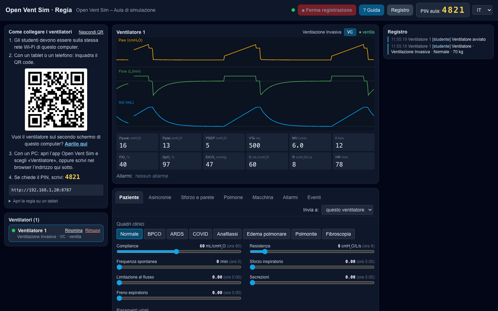</p>

> ⚠️ **Solo per la didattica.** Non è un dispositivo medico e non va mai usato per decisioni cliniche.

---

## Indice

1. [Che cosa fa](#1-che-cosa-fa)
2. [Che cosa ti serve](#2-che-cosa-ti-serve)
3. [Scaricare e installare (5 minuti)](#3-scaricare-e-installare)
4. [Lezione con la regia, passo per passo](#4-lezione-con-la-regia-passo-per-passo)
5. [Usarlo da soli](#5-usarlo-da-soli)
6. [La regia in dettaglio](#6-la-regia-in-dettaglio)
7. [Il registro della sessione](#7-il-registro-della-sessione)
8. [Se qualcosa non va](#8-se-qualcosa-non-va)
9. [Novità](#9-novità)
10. [Per sviluppatori](#10-per-sviluppatori)
11. [Come citare](#11-come-citare)

---

## 1. Che cosa fa

- **Tre apparecchi in uno**: macchina d'anestesia, ventilatore di terapia intensiva (invasiva e non invasiva) e alti flussi.
- **Curve vere**: pressione, flusso e volume calcolati dal modello del polmone, con compliance che cambia con la PEEP, auto-PEEP, sforzi del paziente e asincronie.
- **Loop pressione–volume e flusso–volume**, tracce di **pressione alveolare (Palv)** e **sforzo del paziente (Pmus)**, modalità **PRVC**.
- Un **motore del respiro** che integra l'equazione del moto: auto-PEEP, trigger, ciclaggio e asincronie succedono invece di essere disegnati. **PAV+**, assistita-controllata (A/C), **flusso decelerante**, tracce **Pes e PL**, **P0.1**, **stress index**, **flow index**, **RSBI**, **RCexp**, **PMI**, **EIT** con PEEP trial e pendelluft, **curva P/V lenta** (pressione di apertura delle vie aeree), **rapporto R/I**, il **test di occlusione**.
- Lo **scambio dei gas**: SpO₂, EtCO₂ ed **emogas** (pH, PaCO₂, PaO₂, HCO₃⁻, lattato) escono da un modello con shunt, basso V/Q, spazio morto, diffusione, vasocostrizione ipossica, riserve di O₂ e isteresi del reclutamento.
- **Regia dell'istruttore**: da un computer (o da un tablet) vedi in diretta il ventilatore di ogni studente e cambi il paziente: quadro clinico, meccanica, parametri vitali, asincronie, eventi programmati.
- **Registro della sessione** per il debriefing: chi ha fatto cosa e quando, con l'andamento dei parametri. Si stampa in PDF.
- **Guida passo passo** per chi non ha mai visto un ventilatore.
- **Niente internet, niente account**: funziona sulla rete locale della tua aula. Nessun dato esce dalla stanza.
- Italiano e inglese.

## 2. Che cosa ti serve

| Chi | Che cosa |
|---|---|
| **Istruttore** | Un computer **Windows 10/11** o **Mac** (macOS 11 o successivo). |
| **Studenti** | Un computer Windows/Mac con l'app, **oppure** un tablet/telefono con un browser qualsiasi (Safari, Chrome…). Sui tablet non si installa niente. |
| **Rete** | Tutti sulla **stessa rete Wi-Fi** (o lo stesso router). Internet **non** serve. |

> 💡 Molte reti Wi-Fi di ospedali e università **isolano i dispositivi** fra loro, e lì la regia non vede gli studenti. Se succede, usa un piccolo router tuo o l'hotspot del telefono (vedi [§8](#8-se-qualcosa-non-va)).

## 3. Scaricare e installare

Vai alla pagina **[Releases](https://github.com/fedebarra/open-vent-sim/releases/latest)** e scarica il file giusto per il tuo computer:

| Il tuo computer | File da scaricare |
|---|---|
| Windows | `OpenVentSim-3.4.1-win-x64.exe` (installazione) — oppure `OpenVentSim-3.4.1-portable.exe` (senza installare, si apre e basta) |
| Mac con chip Apple (M1, M2, M3, M4…) | `OpenVentSim-3.4.1-mac-arm64.dmg` |
| Mac con processore Intel | `OpenVentSim-3.4.1-mac-x64.dmg` |

> Se il `.dmg` non si apre, scarica il `.zip` con lo stesso nome: doppio clic per estrarlo, poi trascina **Open Vent Sim** in Applicazioni.

> Non sai che Mac hai? Menu  → **Informazioni su questo Mac**. Se vedi «Chip Apple M…» prendi `arm64`; se vedi «Processore Intel» prendi `x64`.

**Aggiornamenti (dalla 3.3).** A ogni avvio l'app controlla l'ultima versione su GitHub. Con l'installazione Windows la scarica da sola e chiede di riavviare (oppure la installa alla chiusura). Su Mac e con l'`.exe` portatile dice che è uscita una versione nuova e apre il download giusto: si installa sopra la vecchia. Chi ha la 3.2 o precedenti installa la 3.3 a mano una volta.

### Windows

1. Fai doppio clic sul file `.exe`.
2. Windows mostra una finestra blu **«Windows ha protetto il PC»**: è normale per i programmi gratuiti non firmati. Clicca **Ulteriori informazioni** → **Esegui comunque**.
3. Segui l'installazione (Avanti, Avanti, Fine). Trovi **Open Vent Sim** sul desktop.
4. La **prima volta che apri la Regia**, Windows chiede se consentire l'accesso alla rete: spunta **Reti private** (e anche **pubbliche** se la rete dell'aula è segnata come pubblica) e clicca **Consenti accesso**. Senza questo, gli studenti non si collegano.

### Mac

1. Apri il file `.dmg` e **trascina Open Vent Sim nella cartella Applicazioni**.
2. Apri Applicazioni e fai doppio clic su Open Vent Sim. Il Mac dice che **non può verificare lo sviluppatore**: clicca **Fine** (non «Sposta nel cestino»).
3. Apri **Impostazioni di Sistema → Privacy e sicurezza**, scorri in basso: accanto a «Open Vent Sim è stato bloccato» clicca **Apri comunque**, poi conferma con la password.
4. Da qui in poi si apre normalmente. Se chiede di accettare connessioni in entrata, clicca **Consenti**.

## 4. Lezione con la regia, passo per passo

### Istruttore

**1.** Apri Open Vent Sim e scegli **Regia**.

<p align="center">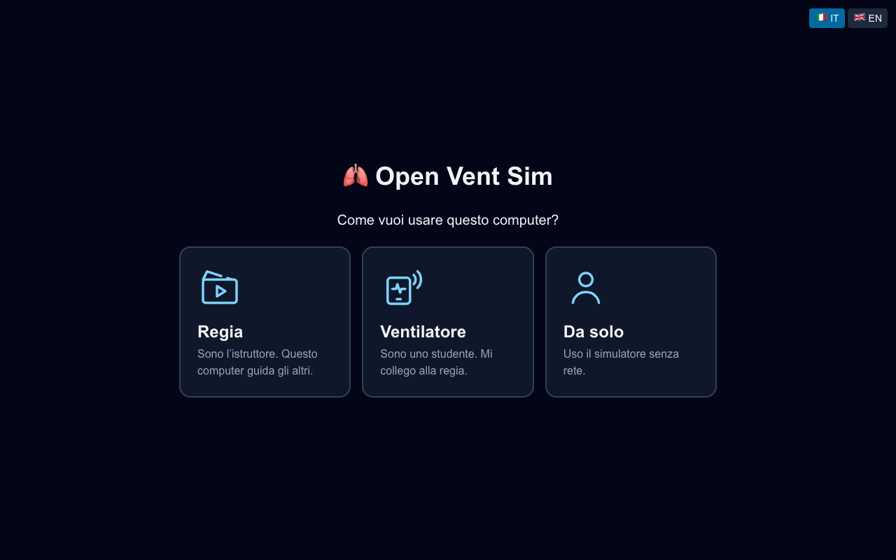</p>

**2.** Si apre la regia. A sinistra trovi tutto quello che serve agli studenti: **QR code**, **indirizzo** e **PIN di 4 cifre** (in alto a destra, in giallo). Il PIN cambia a ogni avvio.

<p align="center">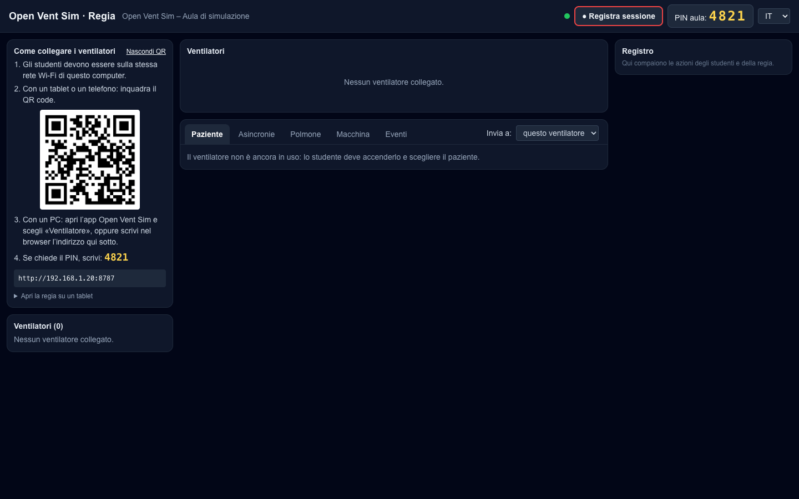</p>

Lascia questa finestra aperta per tutta la lezione: **se la chiudi, l'aula si scollega**.

### Studenti

Hanno tre modi per collegarsi; vanno bene tutti:

- **Tablet o telefono** → inquadrano il **QR code** con la fotocamera. Si apre il simulatore già collegato.
- **PC con l'app** → aprono Open Vent Sim, scelgono **Ventilatore** e cliccano sulla regia trovata. Se non compare, scrivono l'indirizzo che vedono sul tuo schermo (per esempio `192.168.1.20:8787`).
- **PC senza app** → scrivono l'indirizzo nel browser (per esempio `http://192.168.1.20:8787`).

<p align="center">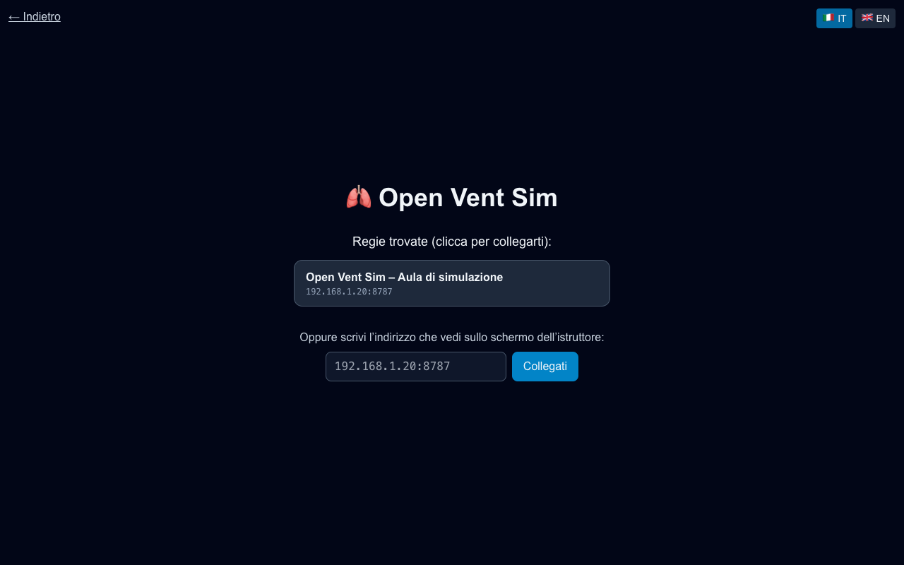</p>

Se chiede il **PIN**, scrivono le 4 cifre che vedi in regia:

<p align="center">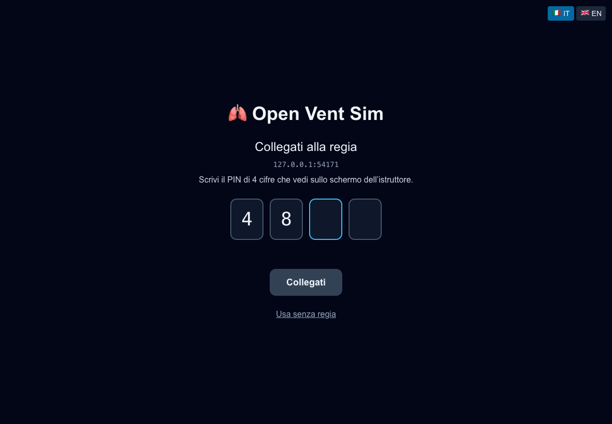</p>

**Una macchina, più schermi.** Se quando un dispositivo entra c'è già un ventilatore acceso, il dispositivo mostra **quella stessa macchina**: proiettore e tablet vedono le stesse curve, e un tocco su uno qualunque cambia la macchina per tutti. Per un ventilatore separato (uno per gruppo) si tocca la freccia indietro → **Stacca**. Se le macchine accese sono più di una, il dispositivo chiede quale mostrare. Per mettere il ventilatore sul proiettore o sulla LIM collegati al computer della regia c'è **Aprilo qui**, sotto il QR.

<p align="center">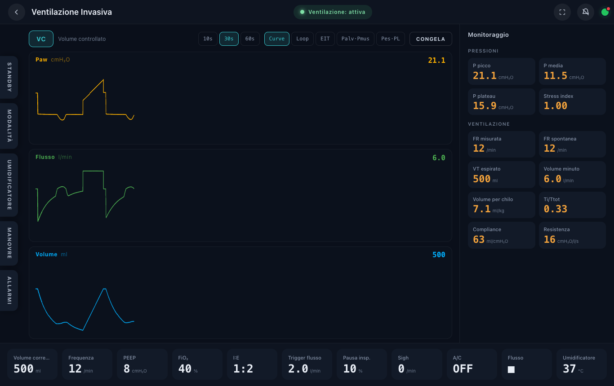</p>

In alto a destra compare un pallino: **verde** vuol dire collegato alla regia (toccalo per leggere lo stato; un puntino rosso sopra indica che la sessione è registrata).

### Lo studente accende la macchina

1. Sceglie l'apparecchio.

<p align="center">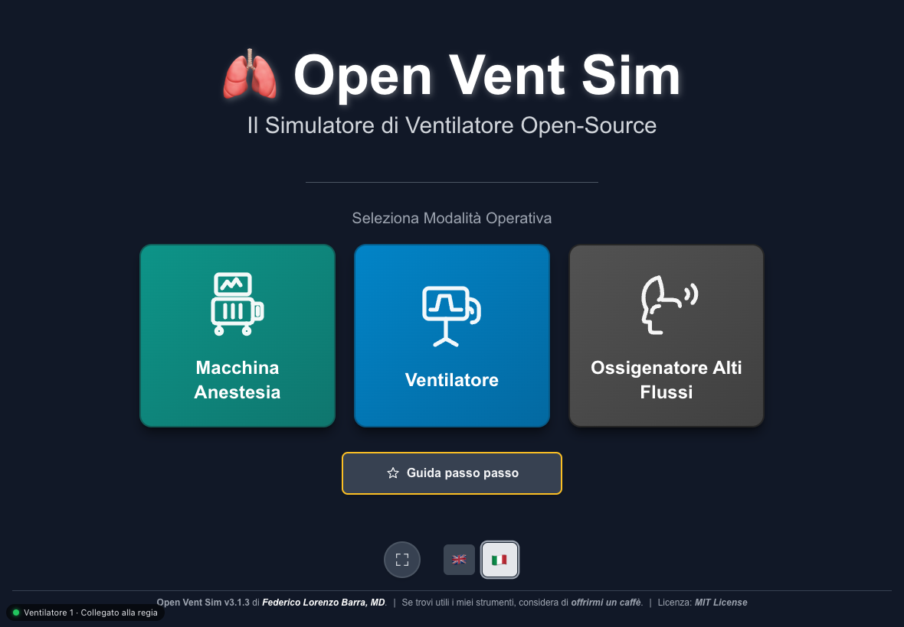</p>

2. Per la terapia intensiva sceglie **invasiva** o **non invasiva**, poi conferma **peso ed età**, come su un ventilatore vero. Il quadro clinico (polmone, asincronie, tracce didattiche) non lo sceglie lo studente: lo decidi tu dalla regia.

<p align="center">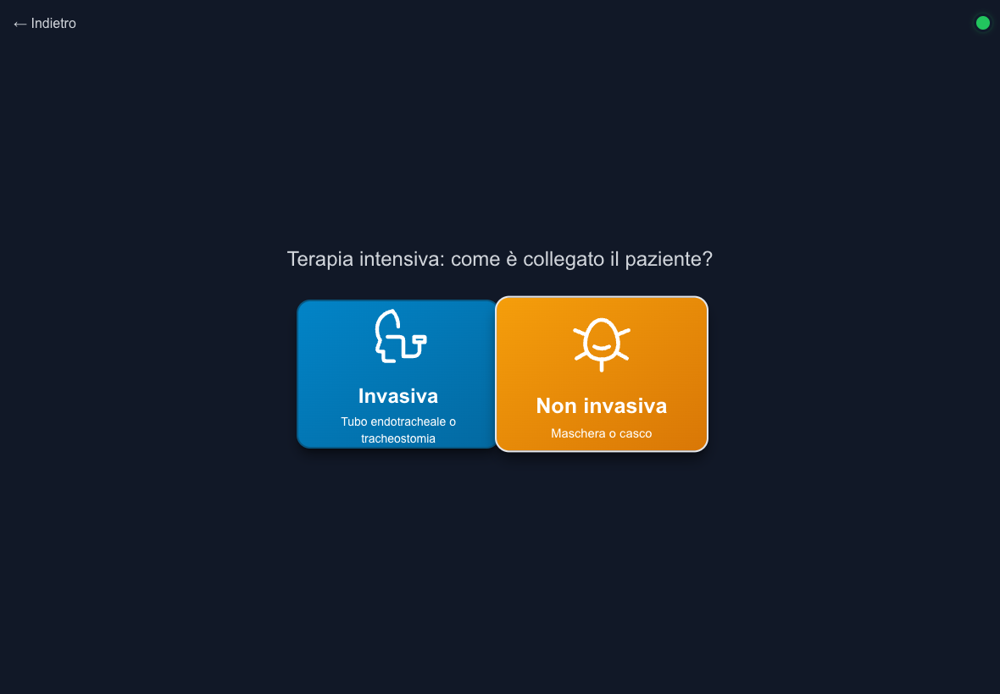 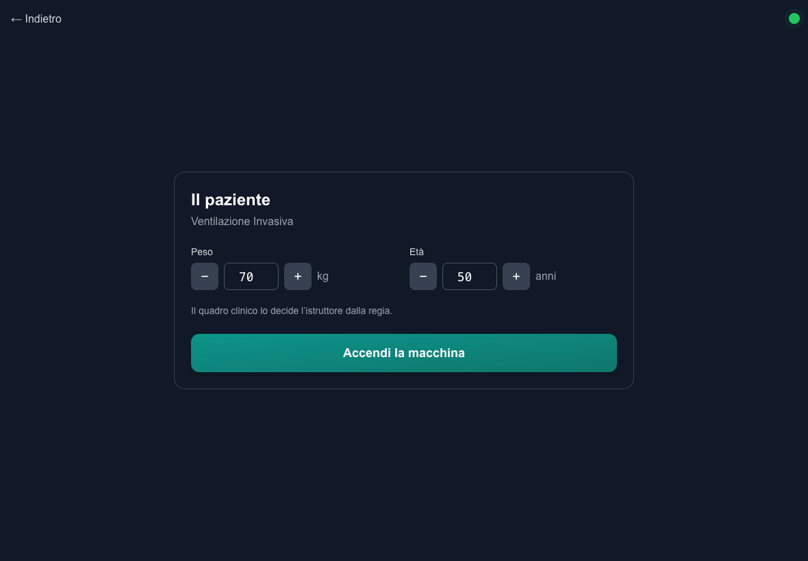</p>

3. Apre il pannello **ON/OFF** (a sinistra; mentre ventila si chiama **Standby**) e preme **AVVIA LA VENTILAZIONE**.

<p align="center">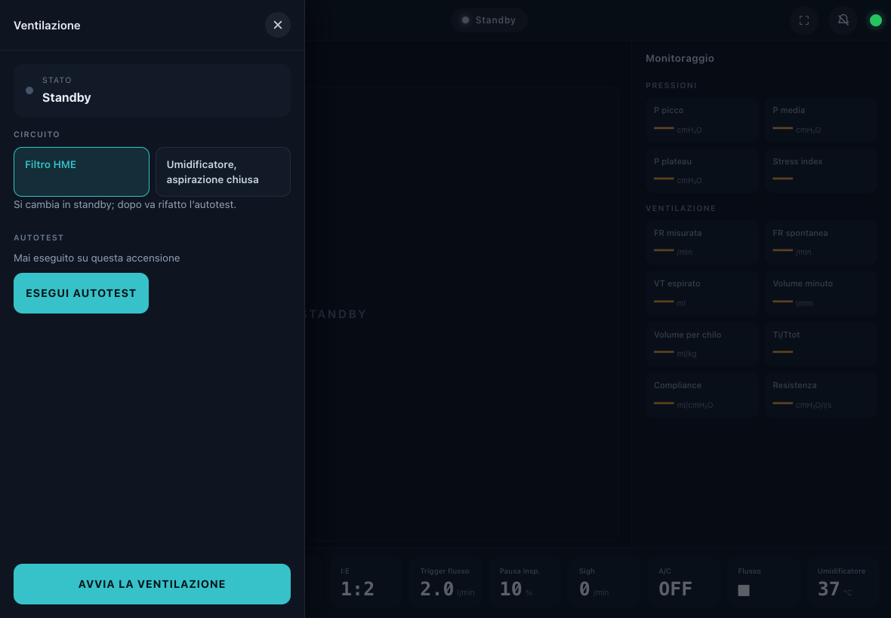</p>

<p align="center">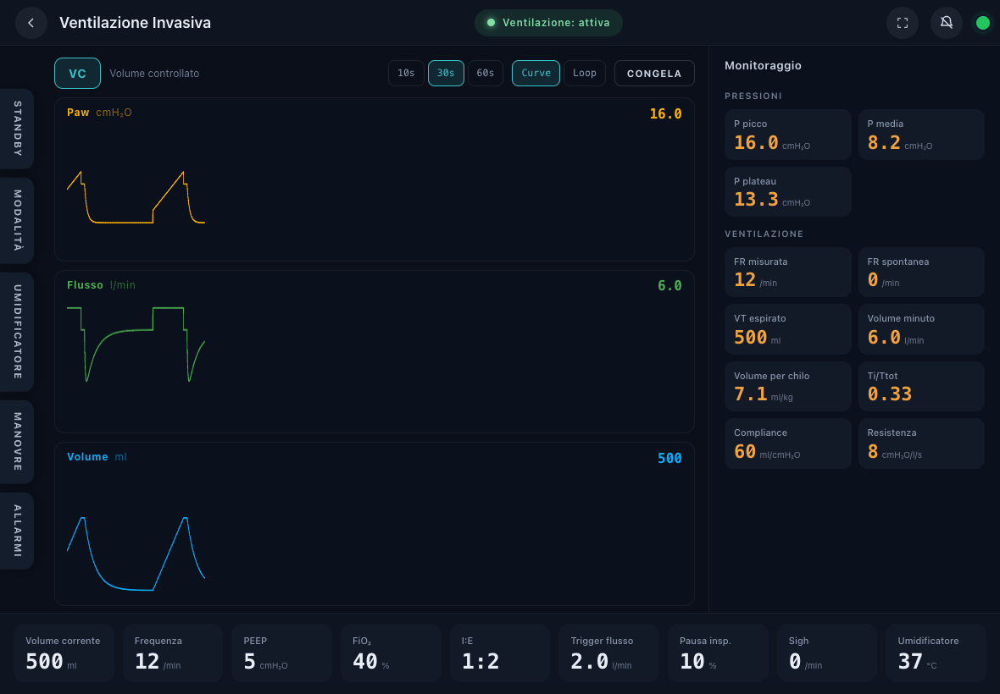</p>

Da questo momento lo vedi in regia, curve comprese, e ogni sua azione compare nel registro a destra.

## 5. Usarlo da soli

Apri l'app e scegli **Da solo**, oppure apri il simulatore nel browser e clicca **Usa senza regia**. Senza regia, nella schermata del paziente compare il riquadro **Impostazioni dell'esercitazione** (quadro polmonare e tracce didattiche) per preparare il caso da soli. Sulla schermata iniziale c'è il pulsante **Guida passo passo**, che accompagna lo studente nella prima ventilazione.

<p align="center">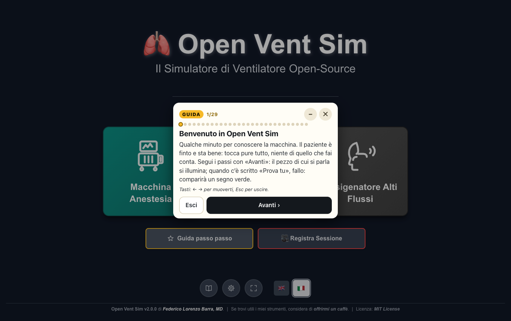</p>

**← Cambia modalità**, in alto a sinistra nella schermata iniziale, torna alla scelta fra Regia, Ventilatore e Da solo.

La macchina d'anestesia parte in **volume controllato**, in standby; la ventilazione **manuale** (pallone) si sceglie nel pannello ON/OFF, con Paw, flusso e CO₂.

<p align="center">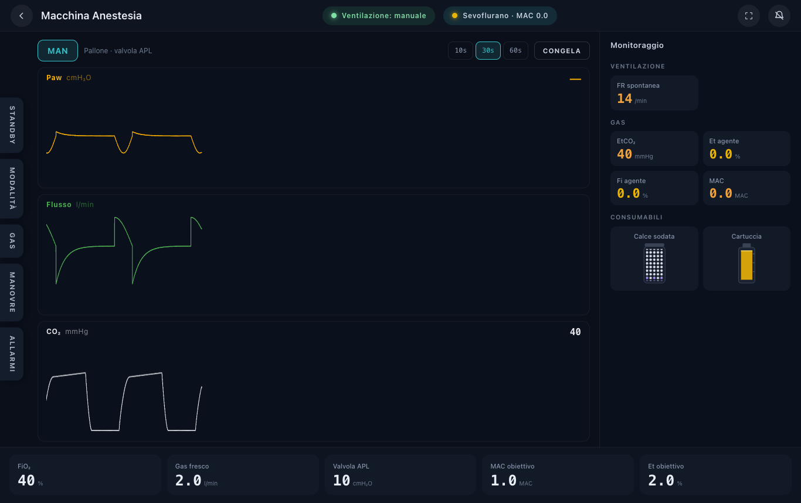</p>

### Curve, loop e pressioni nascoste

Sopra le curve ci sono i tasti **Curve / Loop** e, se abilitato, **Palv·Pmus**:

- **Curve / Loop**: «Loop» mostra l'anello **pressione–volume** e **flusso–volume** dell'ultimo atto. In bianco l'atto in corso, più tenui i due precedenti. **Tieni come riferimento** congela l'anello di adesso in grigio: cambi PEEP o volume e confronti.
- **Palv·Pmus** (spento di serie: su un ventilatore vero non c'è). Lo abilita la regia nella scheda *Macchina*, oppure lo studente da solo spuntando «Mostra le tracce didattiche» nella schermata del paziente. Aggiunge due tracce. **Palv** è la pressione negli alveoli (Paw meno la parte che serve a vincere la resistenza): fa vedere l'auto-PEEP prima di misurarla. **Pmus** è lo sforzo del paziente: dice *quando* tira rispetto alla macchina, cioè tutta la lettura delle asincronie.

<p align="center">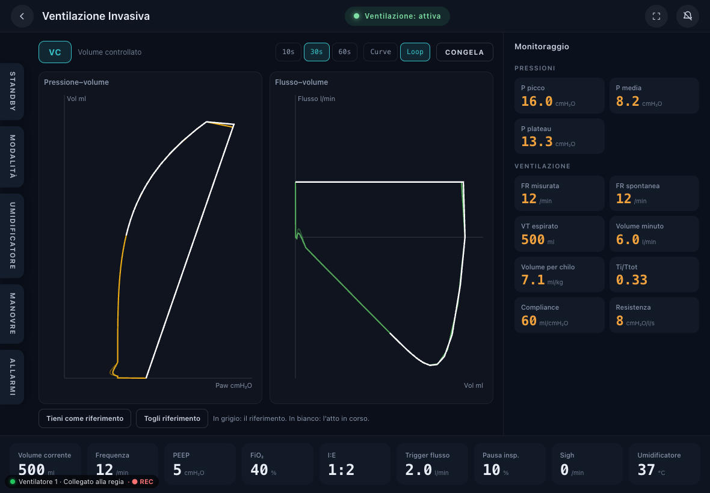</p>
<p align="center">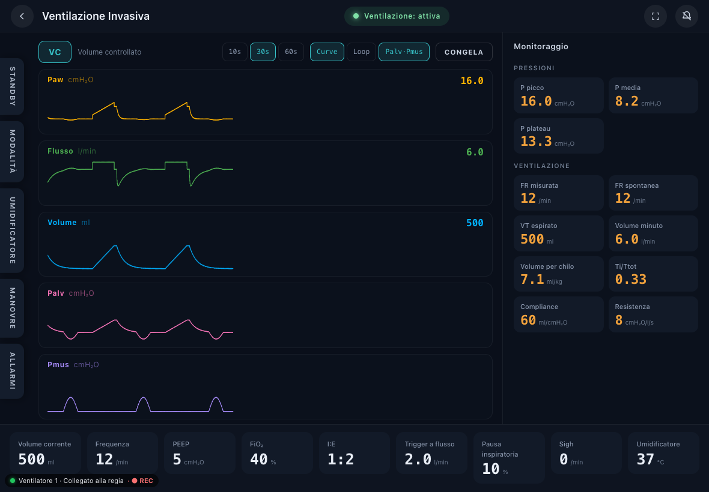</p>

**PRVC** (pressione regolata a volume controllato), in intensiva invasiva: imposti il volume, la macchina parte da un atto di prova a 10 cmH₂O e corregge la pressione di al massimo 3 cmH₂O per atto finché il volume arriva. Se la compliance cala, la pressione sale da sola: è quello che si vuole far notare. Il regolatore legge gli atti erogati davvero: se il paziente tira, la macchina abbassa la pressione.

### Il motore del respiro, l'EIT e le manovre nuove (3.2)

Le curve escono da un **motore del respiro**: l'equazione del moto integrata a 200 Hz, con dentro lo sforzo del paziente. L'auto-PEEP si accumula atto dopo atto, lo sforzo inefficace è uno sforzo vero che non arriva al trigger, il doppio trigger è uno sforzo più lungo dell'inspirazione della macchina. Il motore è stato confrontato con il simulatore di T. Piraino (sim.rtmaven.com, rivisto da G. Bellani): volumi correnti entro l'1-2%, pressioni entro 0,5 cmH₂O (il confronto è in `docs/confronto-rtmaven.md`).

- **PAV+** e **A/C** (trigger aperto in VC, PC, PRVC; spento di default). **Flusso decelerante** in VC.
- **Pes·PL**: pressione esofagea e transpolmonare, con l'artefatto cardiaco.
- **P0.1** (quando il paziente apre gli atti) e **stress index** (VC a flusso quadro) sul display.
- **EIT** (intensiva invasiva): immagine tidal e dinamica, impedenza globale/ventrale/dorsale, pendelluft con gli sforzi vigorosi, e un **PEEP trial** con le curve di collasso e sovradistensione e il loro incrocio (Costa 2009).
- **Manovre**: la pausa espiratoria diventa un **test di occlusione** quando il paziente tira (ΔPocc, Pmus e PL dinamica stimate); la **curva P/V lenta** trova la pressione di apertura delle vie aeree; il **rapporto R/I** (Chen 2020) da PEEP ≥ 10.
- In regia, la scheda **Sforzo e parete**: obesità, addome teso, chiusura delle vie aeree, sforzo vigoroso, respiro irregolare, oscillazioni cardiache, grugnito, espirio attivo; forma dello sforzo, sforzo che risponde al supporto, variabilità atto per atto. La scheda **Macchina** salva e carica uno **scenario** (paziente e macchina) in un file.

| Anestesia | Non invasiva | Alti flussi |
|---|---|---|
| 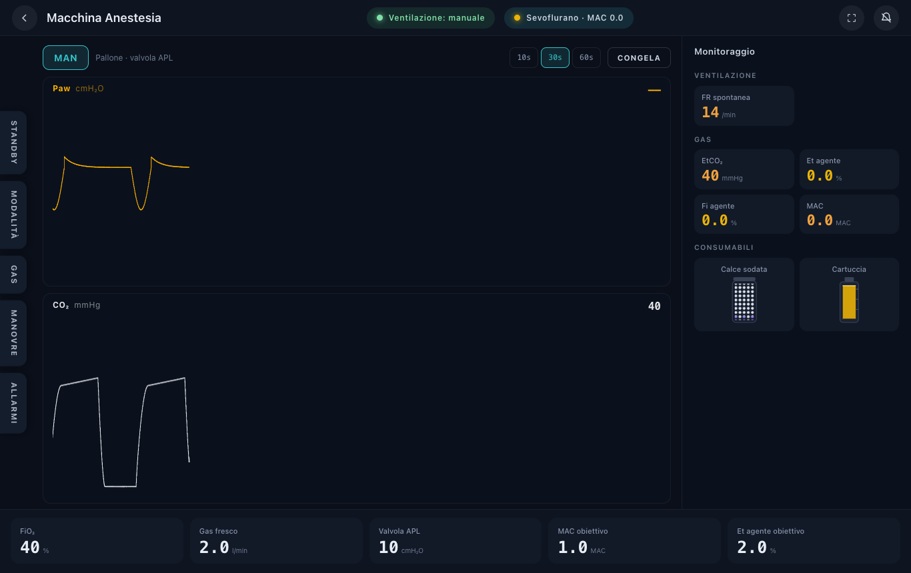 | 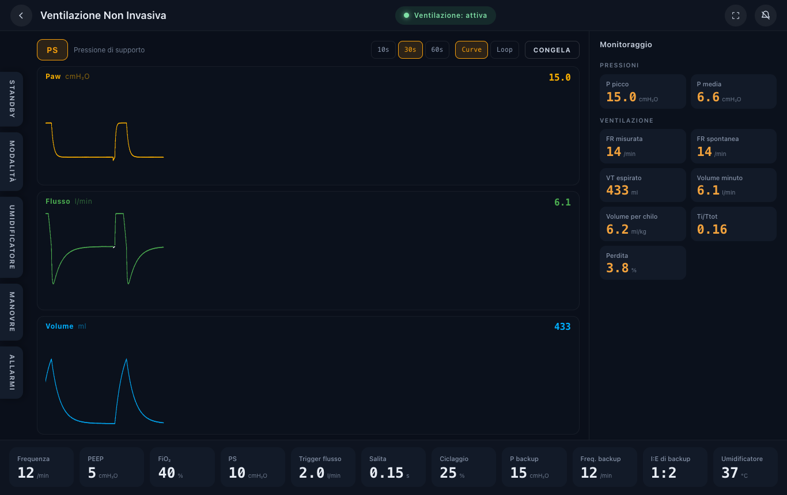 | 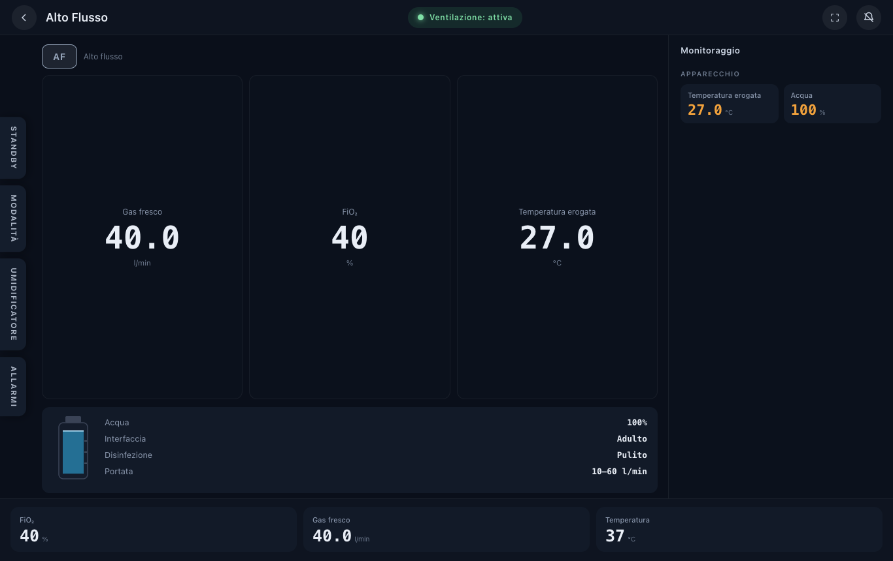 |

## 6. La regia in dettaglio

In alto scegli **a chi mandare** i comandi: *questo ventilatore* (quello selezionato a sinistra) oppure *tutti i ventilatori*.

| Scheda | Che cosa fai |
|---|---|
| **Paziente** | Quadri clinici con un clic (Normale, BPCO, ARDS, COVID, Anafilassi, Edema, Polmonite, Fibroscopia); compliance, resistenza, sforzo, secrezioni; SpO₂, EtCO₂, frequenza cardiaca, pressione media. Con **«Cambia in»** il cambiamento avviene gradualmente (30 s – 5 min) invece che di colpo. |
| **Asincronie** | Sforzo inefficace, doppio ciclo, reverse triggering, fame di flusso, ciclaggio precoce/ritardato, auto-trigger, con la quota degli atti coinvolti. Lo studente vede **solo le curve**, mai il nome: riconoscerla è il suo compito. Sotto, **Colpo di tosse** e **Accesso di tosse**: la Paw al limite alto e l'allarme di pressione. |
| **Polmone** | Reclutabilità e compliance della parete: la compliance cambia con la PEEP. Avvio della **manovra di reclutamento**. |
| **Scambio dei gas** | Shunt fisso, basso V/Q, spazio morto alveolare, diffusione, Hb, temperatura, metabolismo, bicarbonato, portata, BMI, vasodilatatori, NO inalatorio, CO e metaemoglobina; **ventilazione monopolmonare**. In tempo reale PaO₂, PaCO₂, pH, P/F, Qs/Qt, VD/VT, apnea sicura. **Emogas arterioso in tempo reale** come riferimento per il docente (il ventilatore non lo mostra), con gli indici derivati. |
| **Macchina** | Modalità, parametri, avvio/standby, silenzio allarmi, pause inspiratoria ed espiratoria: come se li toccasse lo studente (nel registro risultano fatti dalla regia). |
| **Allarmi** | I limiti d'allarme del ventilatore (basso/alto, acceso/spento), come dal suo pannello Allarmi; **Ripristina i limiti d'avvio**. In PS, CPAP e PAV c'è il tempo di **apnea** (20 s di serie). |
| **Eventi** | Eventi pronti (broncospasmo, tappo di muco, pneumotorace, desaturazione, ipercapnia, induzione, risveglio, decurarizzazione…). Si lanciano subito oppure si mettono in **sequenza** con i tempi, e la sequenza si salva su file per la prossima volta. |

<p align="center">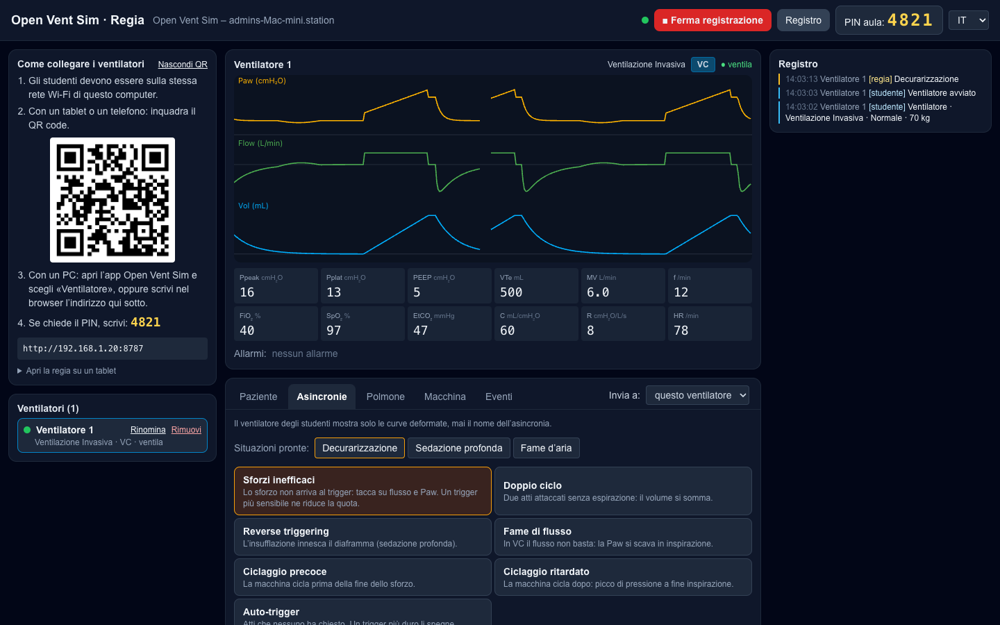</p>

<p align="center">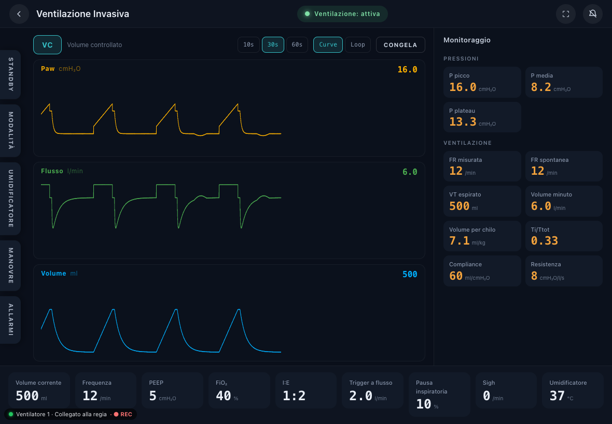</p>

<p align="center">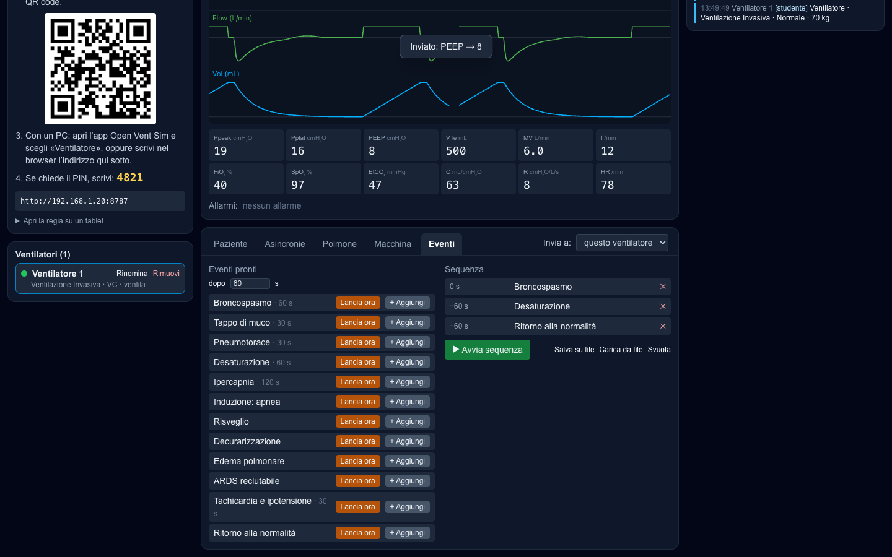</p>

<p align="center">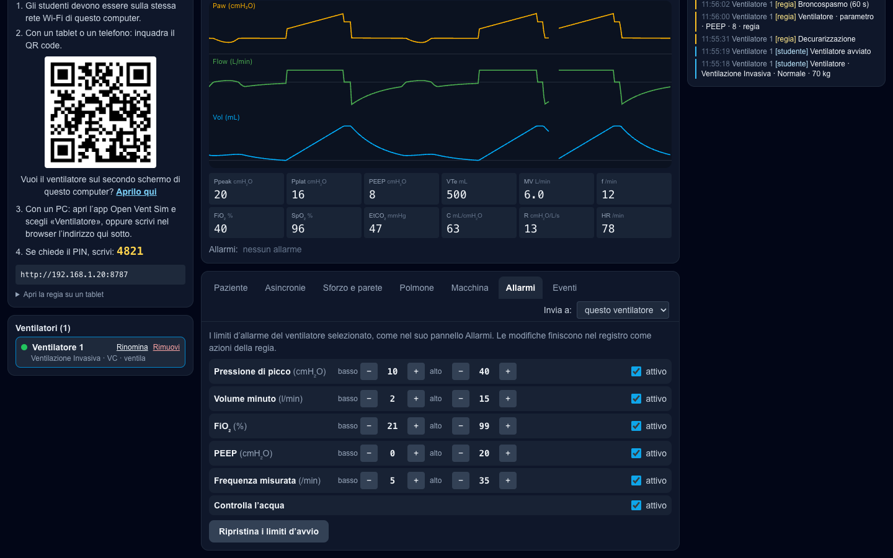</p>

**Regia sul tablet.** Nel riquadro a sinistra apri «Apri la regia su un tablet» e inquadra il QR con il **tuo** tablet: avrai la regia in mano mentre giri per l'aula. Non mostrarlo agli studenti, perché dà il controllo completo.

## 7. Il registro della sessione

1. In regia premi **● Registra sessione**. Sui ventilatori degli studenti compare **● REC**.
2. Conduci la lezione.
3. Premi **■ Ferma registrazione**: si apre il registro.

<p align="center">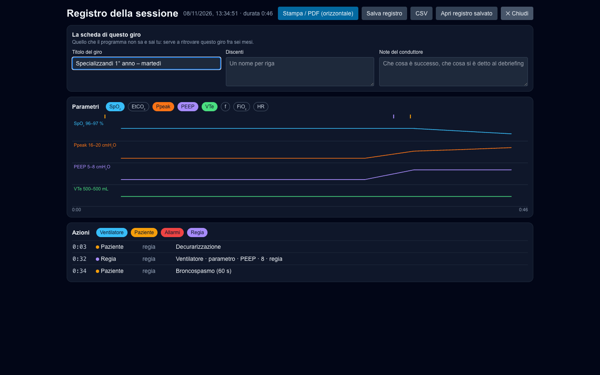</p>

- **La scheda del giro**: titolo, nomi dei discenti, note del debriefing.
- **Parametri**: SpO₂, EtCO₂, Ppeak, PEEP, VTe, frequenza, FiO₂ e HR nel tempo. Accendi e spegni le pastiglie colorate; le tacche in alto segnano le azioni.
- **Azioni**: minuto per minuto (0:00 = inizio della registrazione), divise in *Ventilatore*, *Paziente*, *Allarmi* e *Regia*. Più ritocchi della stessa manopola nello stesso minuto stanno su una riga sola; cliccala per vederli tutti.
- **Stampa / PDF**, **Salva registro** (file `.json` da riaprire dopo con «Apri registro salvato») e **CSV** per Excel.

Il registro resta salvato anche se chiudi e riapri la regia.

## 8. Se qualcosa non va

| Problema | Soluzione |
|---|---|
| Lo studente **non trova la regia** o il QR non si apre | Controlla che sia sulla **stessa Wi-Fi** (non la rete «ospiti»). Su Windows, la prima volta bisogna aver cliccato **Consenti accesso** (vedi §3); se l'hai negato: *Pannello di controllo → Windows Defender Firewall → Consenti app* → spunta Open Vent Sim. |
| Funziona su un PC ma non sui telefoni | La rete Wi-Fi isola i dispositivi («client isolation»), cosa comune negli ospedali. Usa un router tuo o l'**hotspot del telefono**: collega tutti lì, compreso il computer della regia. |
| «PIN sbagliato» | Il PIN cambia a ogni avvio della regia: copia quello che vedi adesso, in alto a destra. |
| Il pallino in alto a destra diventa **arancione** e compare «Rete persa – ricollego…» | Non toccare niente: si ricollega da solo appena la rete torna, e il ventilatore continua a funzionare. |
| «Aperto in un'altra finestra» | Lo stesso ventilatore è aperto in due schede: chiudine una. |
| L'indirizzo è cambiato dalla volta scorsa | È normale: dipende dal router. Usa sempre quello che la regia mostra **oggi**. |
| La porta 8787 è occupata | La regia usa da sola la successiva (8788, 8789…): l'indirizzo giusto è sempre quello sullo schermo. |
| Il Mac dice che l'app è «danneggiata» | Apri il Terminale e scrivi `xattr -cr "/Applications/Open Vent Sim.app"`, poi riapri. |
| Voglio l'interfaccia vecchia (2.x) | Nel browser aggiungi `?legacy=1` all'indirizzo, da soli. |

## 9. Novità

### 3.5.0 — 14 novembre 2026

**Lo scambio dei gas.** SpO₂ ed EtCO₂ non sono più numeri scritti: escono dal paziente.
- **CO₂**: produzione dal peso, dalla temperatura e dal metabolismo; spazio morto anatomico, strumentale (HME, maschera) e alveolare; ventilazione alveolare contata sugli atti erogati, quindi il respiro rapido e superficiale fa salire la CO₂ anche a parità di volume minuto. Due depositi (sangue e tessuti): in apnea la PaCO₂ sale di circa 10 mmHg il primo minuto, poi 3–4 al minuto. L'EtCO₂ si stacca dalla PaCO₂ con lo spazio morto alveolare (embolia, sovradistensione, portata bassa).
- **Acido-base**: pH da Henderson-Hasselbalch, tamponamento acuto, compenso renale lento, BE, lattato quando il trasporto di O₂ non basta.
- **Ossigenazione**: tre compartimenti (ideale, basso V/Q, shunt) alimentati dal polmone a fette dell'EIT. Lo shunt non risponde alla FiO₂, il basso V/Q sì; la PEEP riduce lo shunt solo se il polmone è reclutabile. Diffusione lungo il capillare: con la capacità ridotta la desaturazione compare quando salgono portata e consumo. Contenuti, sangue venoso misto, curva di dissociazione spostata da pH, temperatura e CO₂.
- **Vasocostrizione polmonare ipossica** in due fasi (minuti e decine di minuti), ridotta dagli alogenati sopra 1 MAC, dai vasodilatatori e dall'alcalosi; l'**NO inalatorio** sposta il flusso verso il polmone ventilato.
- **Ventilazione monopolmonare** dalla regia: compliance dimezzata, shunt dal polmone escluso, SpO₂ che scende e poi risale da sola mentre la vasocostrizione lavora.
- **Riserve di O₂ e apnea**: CFR (peso, BMI, PEEP, collasso) e sangue venoso. Preossigenato un adulto regge circa 7 minuti al 90%, in aria meno di uno, l'obeso molto meno; l'ossigenazione apneica a vie aperte tiene la saturazione mentre la CO₂ sale.
- **Isteresi del reclutamento**: dopo un reclutamento il polmone resta aperto finché la PEEP non scende sotto la pressione di chiusura; con FiO₂ alta e PEEP bassa compaiono atelettasie da assorbimento. Lo stesso stato muove compliance, EIT e shunt.
- **CO e metaemoglobina**: saturimetro che sbaglia come quello vero (SpO₂ quasi normale con la CO, verso 85% con la metaemoglobina).
- **Taratura sugli scenari**: la SpO₂ e l'EtCO₂ scritte restano i bersagli; quando cambiano il modello si ritara in mezzo minuto, e da lì aggiunge le conseguenze delle azioni (FiO₂, PEEP, standby, reclutamento).
- **Regia**: scheda *Scambio dei gas*, emogas arterioso in tempo reale come riferimento per il docente, eventi nuovi (monopolmonare, embolia, acidosi metabolica, febbre, brivido, CO, metaemoglobina). Lo scenario salvato porta con sé i parametri dello scambio.

Quattro indici nuovi, letti sulle curve del motore:
- **RSBI** (f/VT, Yang e Tobin) in PS, CPAP e PAV, solo quando respira il paziente (in apnea, sugli atti di backup, resta vuoto). Sopra 105 lo svezzamento regge male.
- **Flow index** in PS (Albani, *Crit Care* 2021): l'esponente di `Q = a + b·tᶜ` dal picco del flusso al ciclaggio. Uno è il flusso che scende in linea retta; sale con lo sforzo e scende alzando il supporto. Nel simulatore la scala è più stretta che nei pazienti (≈1 passivo, ≈2 sforzo forte): conta il verso, non le soglie cliniche 2,6 e 4,5.
- **RCexp**, la costante di tempo espiratoria misurata al 75% del corrente esalato (volume che resta / flusso): R·C nel polmone sano, più lunga nell'ostruito.
- **PMI** nella pausa inspiratoria in PS (Foti 2009): Pplat − (PEEP + PS). Sopra zero il volume l'ha messo anche il diaframma.

### 3.4.1 — 13 novembre 2026

- **Compliance dinamica** sugli atti innescati dal paziente, con l'asterisco: VTi / (Ppicco − PEEP), come la calcolano i ventilatori. Il volume fatto dal diaframma conta, la pressione no: chi tira forte con una PS bassa legge una compliance falsamente alta (PS 5, PEEP 8, C vera 40, sforzo forte → 90*). Quella vera la dà la pausa inspiratoria; P0.1 e Pocc mostrano il drive.

### 3.4.0 — 11 novembre 2026

- **Tosse sulla macchina** dalla regia (scheda *Asincronie*): **Colpo di tosse** o **Accesso di tosse** (quattro colpi di fila, sempre più deboli). La Paw sale fino al limite alto della pressione di picco, la macchina interrompe l'insufflazione, suona l'allarme di pressione; un flusso espiratorio brusco, poi il polmone si riempie.

### 3.3.0 — 10 novembre 2026

Dal primo collaudo in aula:
- **Una macchina, più schermi**: un dispositivo che entra con un ventilatore già acceso mostra quella stessa macchina e la comanda; **Stacca** per un ventilatore separato, **Continua da qui** se lo schermo principale si scollega. In regia «▣ +1» accanto a un ventilatore mostrato su altri schermi.
- **Allarme d'apnea** a tempo (PS, CPAP, PAV), anche mentre ventila il backup. In CPAP un paziente in apnea ora legge frequenza 0.
- Scheda **Allarmi** in regia: limiti modificabili a distanza, o riportati a quelli d'avvio.
- Curva del **flusso** in ventilazione manuale (pallone), compresi gli atti dati a mano.
- La macchina d'anestesia parte in volume controllato e non suona più per l'Et agente a vaporizzatore chiuso.
- Il primo pannello della macchina si chiama **ON/OFF** a macchina spenta.
- **Cambia modalità** dalla schermata iniziale in modalità Da solo; **Aprilo qui** per il secondo schermo, sotto il QR.
- **Aggiornamenti da GitHub** a ogni avvio (automatici con l'installazione Windows, link al download su Mac e con l'exe portatile).

### 3.2.0 — 9 novembre 2026

- Motore del respiro (equazione del moto, deterministico per l'aula in rete), confrontato con sim.rtmaven.com.
- PAV+, A/C, flusso decelerante, Pes·PL, P0.1, stress index, EIT con PEEP trial e pendelluft.
- Test di occlusione, curva P/V lenta (pressione di apertura delle vie aeree), rapporto R/I.
- Regia: scheda *Sforzo e parete*, salvataggio e caricamento dello scenario. Il PRVC legge gli atti erogati.
- NIV: dalla regia una **perdita vera della maschera** (l/min): VTi sopra VTe, ciclaggio ritardato, auto-trigger, pressione che non arriva con la maschera staccata. Nuova misura *Perdita* in l/min.
- **Ventilatore sul secondo schermo**: un pulsante della regia apre un ventilatore già collegato, a tutto schermo sul proiettore o sulla LIM (Esc per uscire dal tutto schermo). I discenti continuano a non installare niente: qualunque browser sulla stessa rete (iPad compreso) apre il ventilatore dal QR o dall'indirizzo col PIN.
- Visita guidata: i passi per ogni funzione nuova.

### 3.1.3 — 8 novembre 2026

- Il piè di pagina mostra la versione vera dell'app (prima diceva sempre 2.0.0).
- Tolti dalla schermata iniziale i pulsanti che non facevano niente (registrazione, impostazioni, manuale): la registrazione si avvia dalla regia.
- Lo stato del collegamento è un pallino in alto a destra, e non copre più il piè di pagina né la barra dei parametri.

### 3.1.2 — 8 novembre 2026

- Lo studente collegato alla regia inserisce solo peso ed età: quadro polmonare e tracce didattiche li decide l'istruttore. Da soli restano disponibili, separati come «Impostazioni dell'esercitazione».

### 3.1.1 — 8 novembre 2026

- Barra dei parametri: i nomi lunghi («Pausa inspiratoria») non vanno più a capo; sulla tessera c'è il nome corto, quello intero nel suggerimento.

### 3.1 — 8 novembre 2026

- **Loop** pressione–volume e flusso–volume, con anello di riferimento da confrontare.
- Tracce **Palv** (pressione alveolare) e **Pmus** (sforzo del paziente).
- Modalità **PRVC** in intensiva invasiva.
- Corretto: un paziente che ricomincia a respirare alla stessa frequenza della macchina (decurarizzazione) ora mostra gli sforzi sulle curve.

### 3.0 — 8 novembre 2026

- **Regia sulla rete locale**: server integrato nell'app, QR, PIN, ricerca automatica della regia, riconnessione automatica, più ventilatori insieme, regia anche da tablet.
- **Nuove schermate e nuovo motore**: un solo layout per anestesia, intensiva invasiva e NIV, alti flussi. Polmone con compliance dipendente dalla PEEP, auto-PEEP, sforzo del paziente e sette asincronie, manovra di reclutamento, consumabili, umidificatore.
- **Registro della sessione** avviato dalla regia, con stampa in PDF.
- **Guida passo passo** (familiarizzazione), in italiano e inglese.
- **App desktop** per Windows e Mac; funziona **senza internet** (prima React e Tailwind arrivavano da CDN esterni).
- Nuova grafica della schermata iniziale, con icone originali.
- Lingua presa dal sistema e ricordata.

## 10. Per sviluppatori

```bash
git clone https://github.com/fedebarra/open-vent-sim.git
cd open-vent-sim
npm install
npm run dev            # sviluppo, http://localhost:3000 (solo simulatore)
npm run server         # build + server d'aula sulla rete locale (porta 8787)
npm run desktop        # app Electron
npm test               # test unitari + test del server
npm run test:e2e       # test end-to-end (regia + studenti in due browser)
npm run screenshots    # rigenera tutte le immagini di questo README
npm run dist:mac       # installer .dmg   (npm run dist:win per Windows)
```

- `device/`: motore e schermate del ventilatore.
- `remote/`: regia, collegamento, registro. `server/ovs-server.mjs`: server HTTP + WebSocket + annuncio UDP sulla rete locale. `electron/`: app desktop. `tour/`: guida passo passo.
- Le release si costruiscono da sole con GitHub Actions quando si pubblica un tag `v*`.

**Requisiti per lo sviluppo:** Node.js 20 o successivo.

---

## 11. Come citare

Se usi Open Vent Sim in un corso, una tesi, un poster o un articolo, cita l'articolo che lo descrive:

> Barra FL, Ricci S, Moro E, Travěnec J, Costa A, Carenzo L, Rodella G, Vaschetto R. *Simulator development using natural language: clinician-led innovation through artificial intelligence.* Advances in Simulation. 2026;11(1). [doi:10.1186/s41077-026-00467-2](https://doi.org/10.1186/s41077-026-00467-2)

```bibtex
@article{barra2026openventsim,
  author  = {Barra, Federico Lorenzo and Ricci, Serena and Moro, Edoardo and Trav{\v{e}}nec, Ji{\v{r}}{\'i} and Costa, Alessandro and Carenzo, Luca and Rodella, Giovanna and Vaschetto, Rosanna},
  title   = {Simulator development using natural language: clinician-led innovation through artificial intelligence},
  journal = {Advances in Simulation},
  year    = {2026},
  volume  = {11},
  number  = {1},
  doi     = {10.1186/s41077-026-00467-2}
}
```

Su GitHub lo stesso riferimento è nel pulsante **«Cite this repository»** (file `CITATION.cff`).

---

### Ringraziamenti

Sviluppato all'Università del Piemonte Orientale, Novara. Gruppo clinico: F.L. Barra MD, E. Moro MD, L. Carenzo MD, A. Costa MD, G. Rodella RN, R. Vaschetto MD PhD. Facilitatori tecnici: S. Ricci PhD, J. Travenec MSc. Grazie a tutti gli specializzandi di Anestesia che hanno dato il loro contributo.

**Immagini per presentazioni e articoli:** in [`docs/press/`](docs/press) ci sono gli screenshot in alta risoluzione (2880×1800), in italiano e in inglese, liberi da usare con la licenza del progetto.

**Supporto:** [Issues](https://github.com/fedebarra/open-vent-sim/issues) · federico.barra@med.uniupo.it

**Licenza:** MIT. Le icone sono disegni originali del progetto.
