# Open Vent Sim

**A free, open-source simulator of ICU ventilator, anaesthesia machine and high-flow oxygen — with an instructor console that runs on your classroom's own network.**

[Versione italiana](README.it.md) · Version 3.10.0 — 28 November 2026 · MIT licence

📄 **The paper:** [*Simulator development using natural language: clinician-led innovation through artificial intelligence*](https://doi.org/10.1186/s41077-026-00467-2), Advances in Simulation 2026. If you use Open Vent Sim in a course, a thesis or a paper, [please cite it](#11-how-to-cite).

<p align="center"><a href="https://fedebarra.github.io/open-vent-sim/video.html">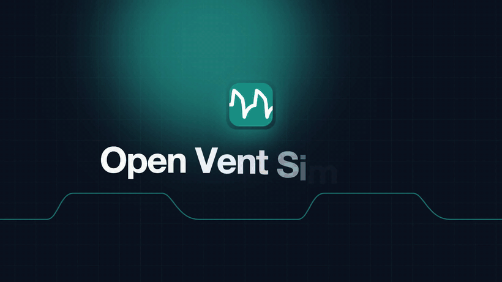</a><br><b><a href="https://fedebarra.github.io/open-vent-sim/video.html">▶ Watch the 90-second video</a></b></p>

> ⚠️ **For education only.** Not a medical device. Never use it for clinical decisions.

---

## Contents

1. [What it does](#1-what-it-does)
2. [What you need](#2-what-you-need)
3. [Download and install (5 minutes)](#3-download-and-install)
4. [Running a class, step by step](#4-running-a-class-step-by-step)
5. [Using it on your own](#5-using-it-on-your-own)
6. [The instructor console in detail](#6-the-instructor-console-in-detail)
7. [The session log](#7-the-session-log)
8. [Troubleshooting](#8-troubleshooting)
9. [What's new](#9-whats-new)
10. [For developers](#10-for-developers)
11. [How to cite](#11-how-to-cite)

---

## 1. What it does

- **Three machines in one**: anaesthesia workstation, ICU ventilator (invasive and non-invasive) and high-flow oxygen.
- **Real waveforms**: pressure, flow and volume come from a lung model with PEEP-dependent compliance, auto-PEEP, patient effort and asynchronies.
- **Pressure–volume and flow–volume loops**, **alveolar pressure (Palv)** and **patient effort (Pmus)** traces, **PRVC** mode.
- A **breathing engine** that integrates the equation of motion: auto-PEEP, triggers, cycling and asynchronies happen instead of being drawn. **PAV+**, assist-control (A/C), **decelerating flow**, **Pes and PL** traces, **P0.1**, **stress index**, **flow index**, **RSBI**, **RCexp**, **PMI**, **EIT** with PEEP trial and pendelluft, **low-flow P/V curve** (airway opening pressure), **R/I ratio**, the **occlusion test**. **Neural assist (NEURO)** driven by the diaphragm's electrical activity (**EAdi**), with an oesophageal catheter the learner places by reading four ECG leads.
- **Gas exchange**: SpO₂, EtCO₂ and the **blood gas** (pH, PaCO₂, PaO₂, HCO₃⁻, lactate) come from a model with shunt, low V/Q, dead space, diffusion, hypoxic vasoconstriction, O₂ stores and recruitment hysteresis.
- **Instructor console**: from one computer (or tablet) you see every learner's ventilator live and change the patient: clinical picture, mechanics, vital signs, asynchronies, timed events.
- **Session log** for the debriefing: who did what and when, with parameter trends. Prints to PDF.
- **Guided tour** for people who have never touched a ventilator.
- **No internet, no accounts**: it runs on your room's local network. No data leaves the room.
- English and Italian.

### See it in action

<table>
<tr><td width="50%" valign="top">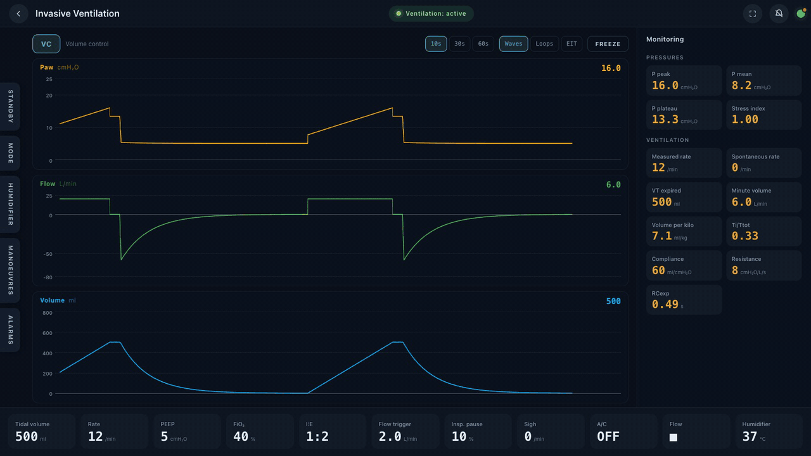<br><sub>Waveforms from a real breathing engine</sub></td><td width="50%" valign="top">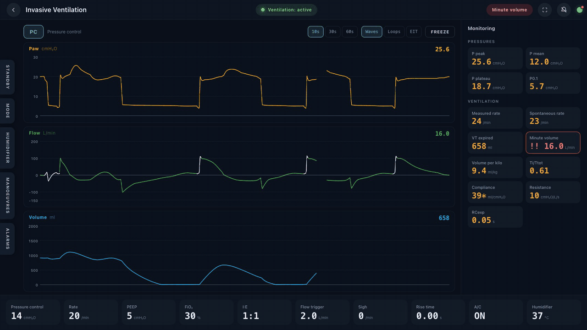<br><sub>The console loads a published case: the learner sees the asynchrony, never its name</sub></td></tr>
<tr><td width="50%" valign="top">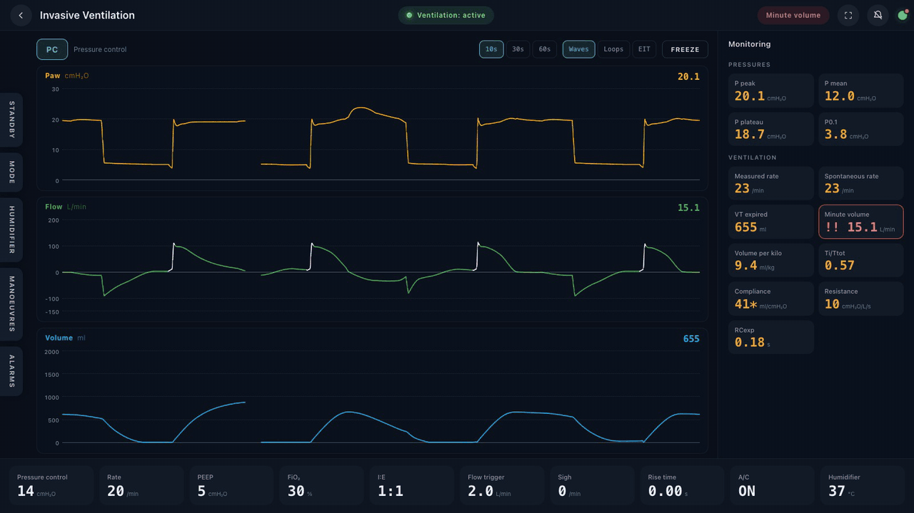<br><sub>The patient coughs: Paw hits the limit and the alarm sounds</sub></td><td width="50%" valign="top">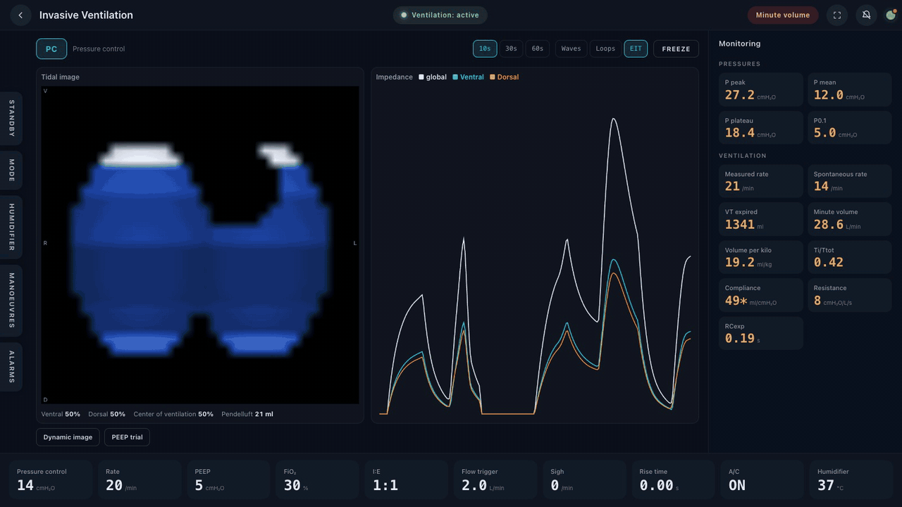<br><sub>EIT with pendelluft and PEEP trial</sub></td></tr>
<tr><td width="50%" valign="top">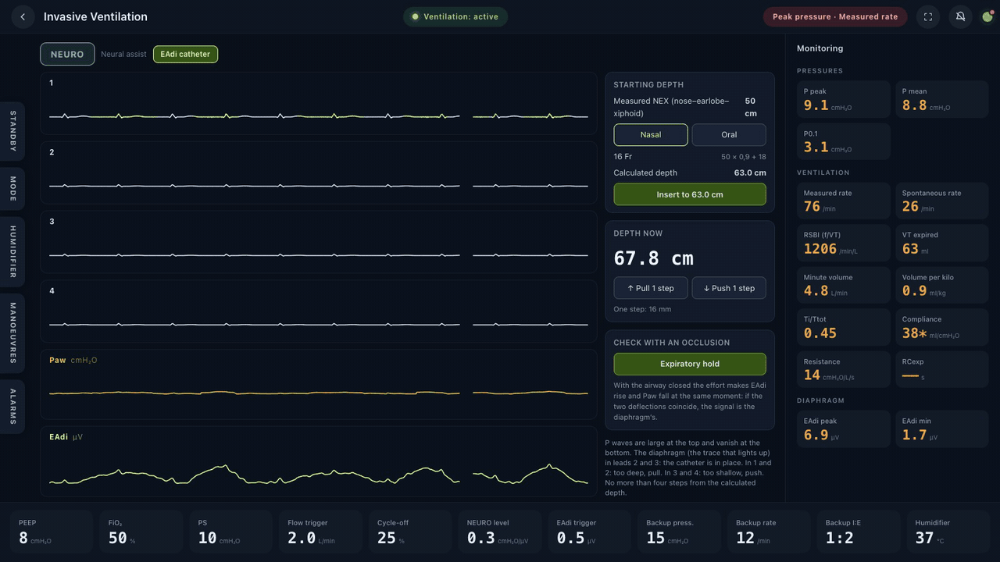<br><sub>Neural assist: the learner pulls the EAdi catheter into place by reading four oesophageal ECG leads</sub></td><td width="50%" valign="top">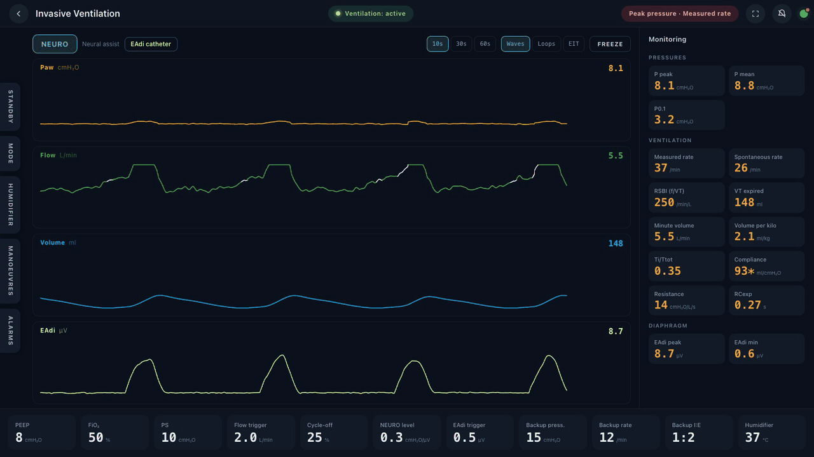<br><sub>NEURO: the pressure follows the diaphragm</sub></td></tr>
<tr><td width="50%" valign="top">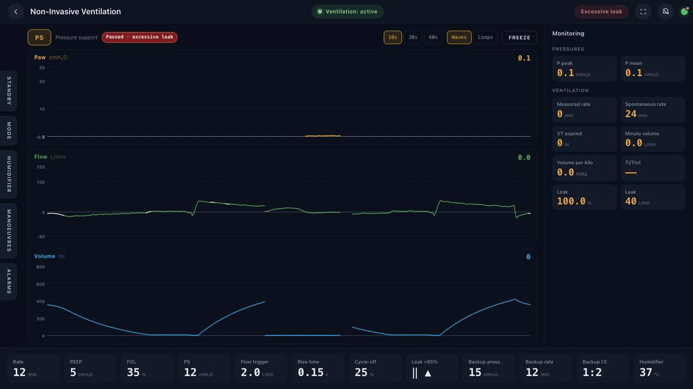<br><sub>NIV: the mask comes off, the machine pauses and alarms</sub></td><td width="50%" valign="top">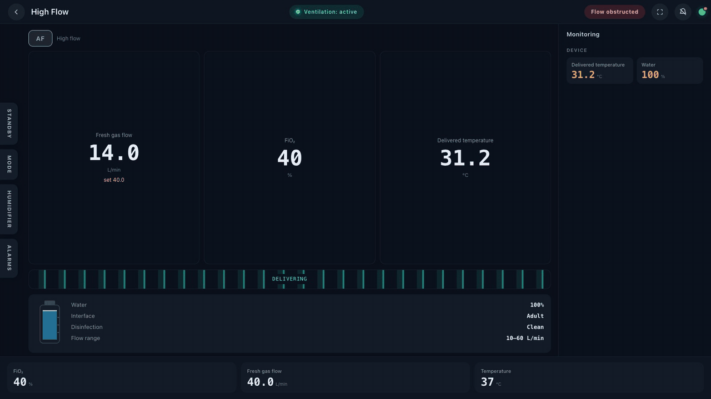<br><sub>High flow: the instructor blocks the cannula and the device says so</sub></td></tr>
<tr><td width="50%" valign="top">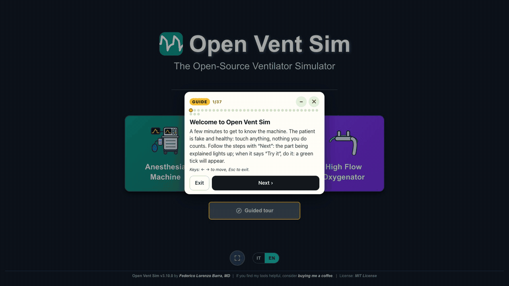<br><sub>A guided tour on every screen</sub></td><td width="50%"></td></tr>
</table>

## 2. What you need

| Who | What |
|---|---|
| **Instructor** | A **Windows 10/11** or **Mac** (macOS 11 or later) computer. |
| **Learners** | A Windows/Mac computer with the app, **or** any tablet/phone with a browser (Safari, Chrome…). Nothing to install on tablets. |
| **Network** | Everyone on the **same Wi-Fi** (or the same router). Internet is **not** needed. |

> 💡 Many hospital and university Wi-Fi networks **isolate devices** from each other, so the console cannot see the learners. If that happens, use a small router of your own or a phone hotspot (see [§8](#8-troubleshooting)).

## 3. Download and install

Go to **[Releases](https://github.com/fedebarra/open-vent-sim/releases/latest)** and download the right file:

| Your computer | File |
|---|---|
| Windows | `OpenVentSim-3.10.0-win-x64.exe` (installer) — or `OpenVentSim-3.10.0-portable.exe` (no install, just run it) |
| Mac with Apple chip (M1, M2, M3, M4…) | `OpenVentSim-3.10.0-mac-arm64.dmg` |
| Mac with Intel processor | `OpenVentSim-3.10.0-mac-x64.dmg` |

> If the `.dmg` won't open, download the `.zip` with the same name: double-click to extract, then drag **Open Vent Sim** into Applications.

> Not sure which Mac? Apple menu  → **About This Mac**. "Chip Apple M…" → `arm64`; "Processor Intel" → `x64`.

**Updates (from 3.3).** At every start the app checks the latest release on GitHub; from 3.9.1 also every few hours and when the network is back. With the Windows installer it downloads the new version by itself and offers to restart (or installs it when you quit). On Mac and with the portable `.exe` it offers the right download: install it over the old one. The first screen shows your version, what's new and **Check for updates** (on Mac also in the app menu); on the console it is only a small badge, so nothing covers a lesson. If you have 3.2 or earlier, install the new version by hand once.

### Windows

1. Double-click the `.exe`.
2. A blue **"Windows protected your PC"** box appears: normal for free unsigned programs. Click **More info** → **Run anyway**.
3. Next, Next, Finish. **Open Vent Sim** is on your desktop.
4. **The first time you open the Instructor console**, Windows asks about network access: tick **Private networks** (and **Public** if the classroom network is marked public) and click **Allow access**. Without this, learners can't connect.

### Mac

1. Open the `.dmg` and **drag Open Vent Sim into Applications**.
2. Double-click it in Applications. macOS says it **cannot verify the developer**: click **Done** (not "Move to Bin").
3. Open **System Settings → Privacy & Security**, scroll down, click **Open Anyway** next to "Open Vent Sim was blocked", and confirm with your password.
4. From now on it opens normally. If asked to accept incoming connections, click **Allow**.

## 4. Running a class, step by step

### Instructor

**1.** Open Open Vent Sim and choose **Instructor**.

<p align="center">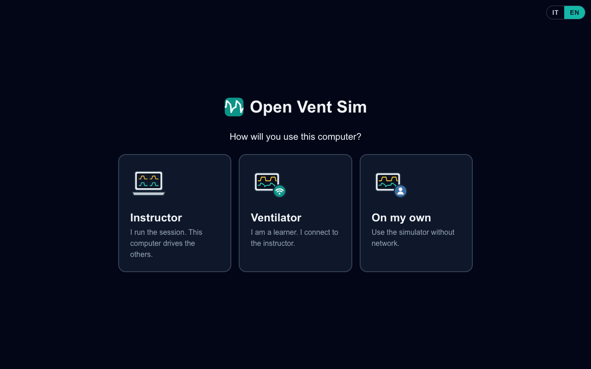</p>

**2.** The console opens. On the left is everything the learners need: **QR code**, **address** and the **4-digit PIN** (top right, in yellow). The PIN changes every time.

<p align="center">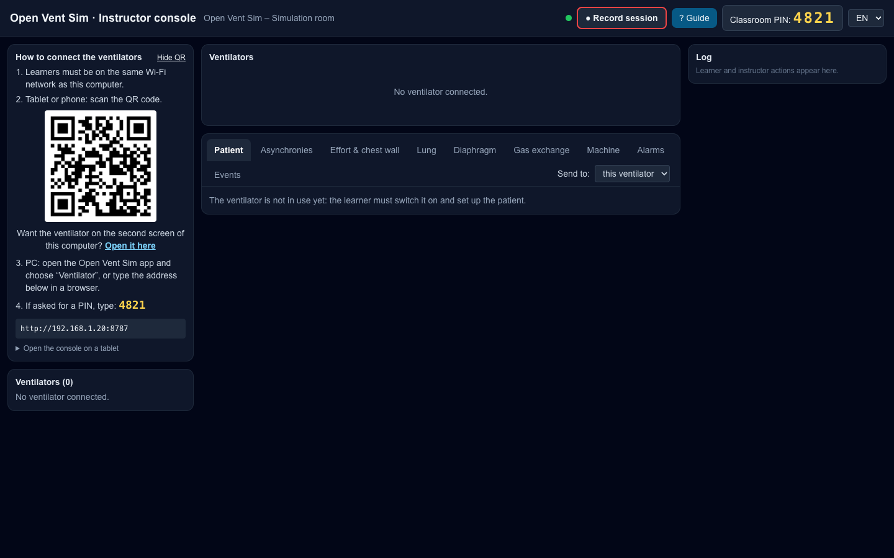</p>

Keep this window open for the whole class: **closing it disconnects the room**.

### Learners

Any of these works:

- **Tablet or phone** → scan the **QR code** with the camera. The simulator opens already connected.
- **PC with the app** → open Open Vent Sim, choose **Ventilator**, click the instructor that appears. If none appears, type the address shown on your screen (e.g. `192.168.1.20:8787`).
- **PC without the app** → type the address in a browser (e.g. `http://192.168.1.20:8787`).

<p align="center">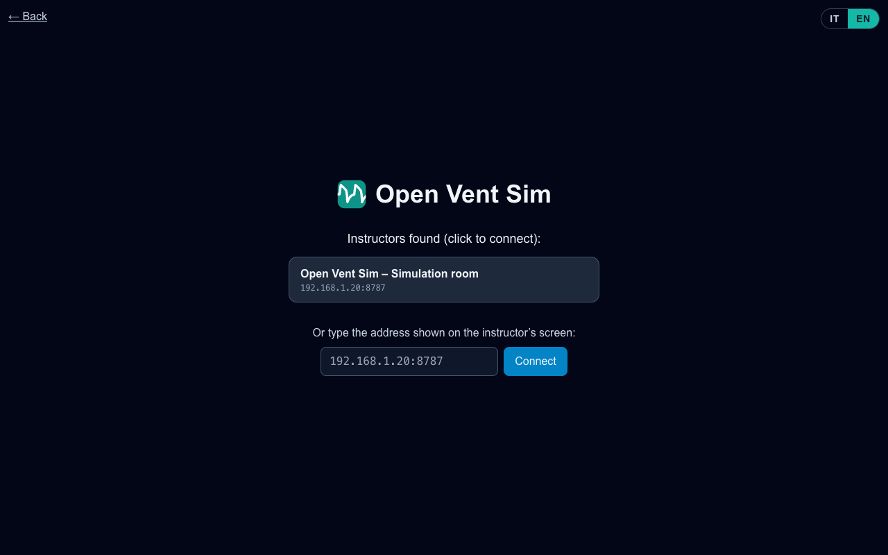</p>

If asked for a **PIN**, they type the 4 digits shown on the console:

<p align="center">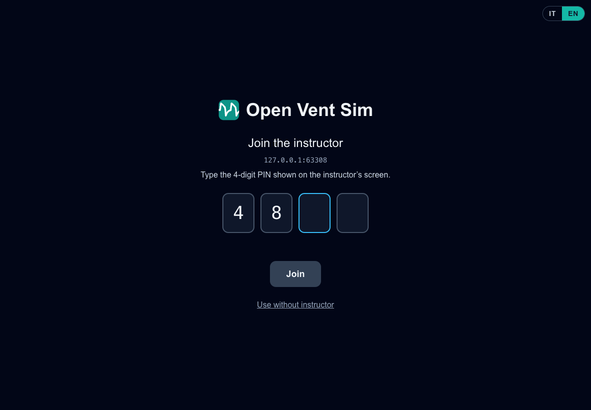</p>

**One machine, several screens.** If a ventilator is already on when a device joins, the device shows **that same machine**: the projector and the tablets see the same waveforms, and a tap on any of them changes the machine for everyone. For a separate ventilator (one per group) tap the back arrow → **Detach**. If several machines are on, the device asks which one to show. To put the ventilator on the projector or interactive whiteboard connected to the console's computer, use **Open it here** under the QR code.

<p align="center">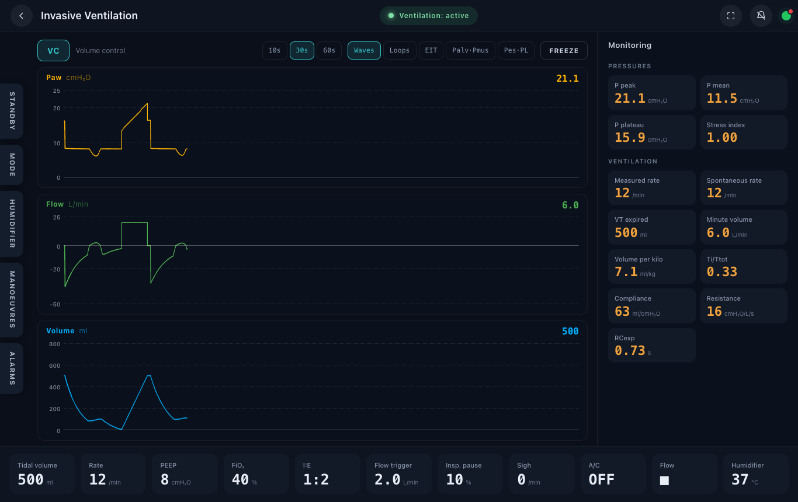</p>

A small dot appears in the top-right corner: **green** means connected to the instructor (tap it to read the status; a small red mark on it means the session is being recorded).

### The learner switches the machine on

1. Choose the machine.

<p align="center">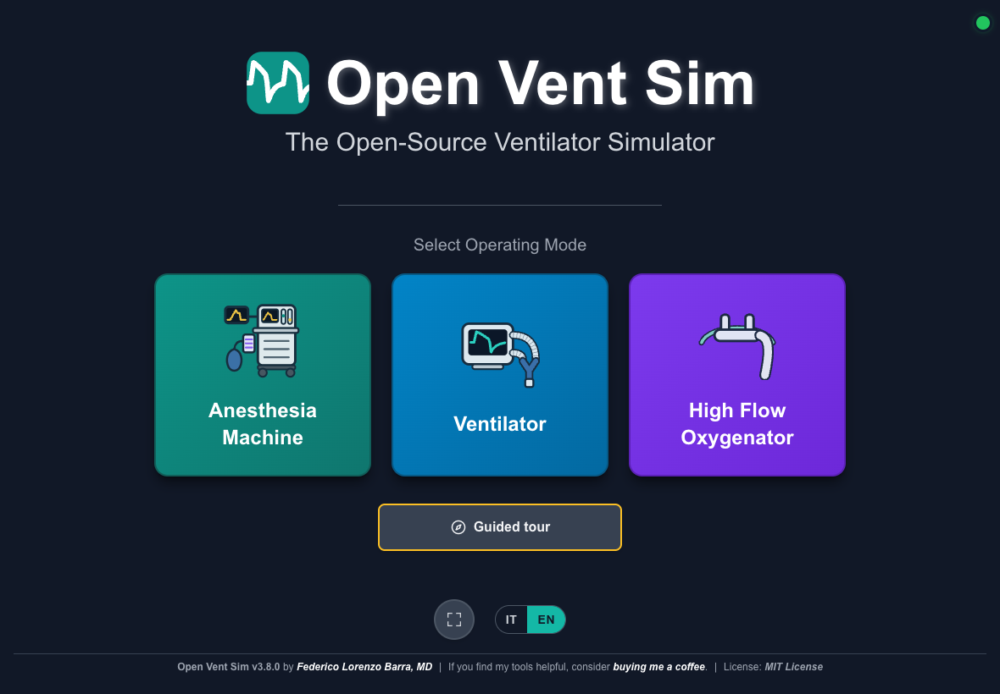</p>

2. For the ICU, choose **invasive** or **non-invasive**, then confirm **weight and age**, as on a real ventilator. The clinical picture (lung, asynchronies, teaching traces) is not the learner's choice: you set it from the console.

<p align="center">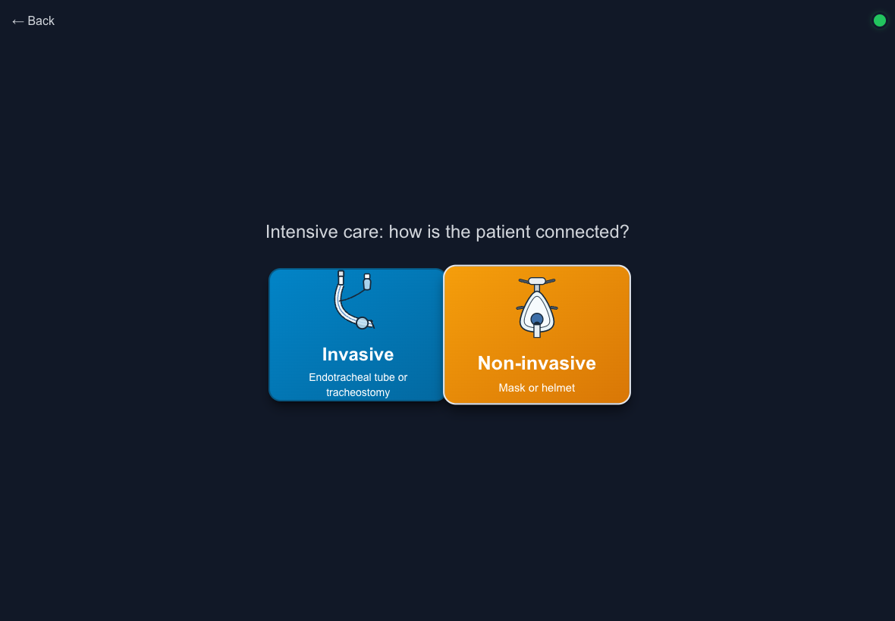 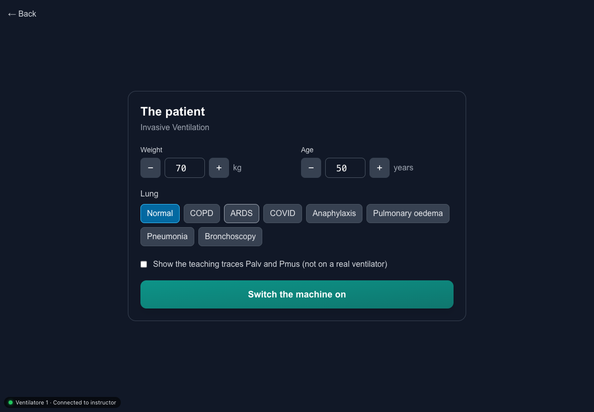</p>

3. Open the **ON/OFF** drawer (left; it is called **Standby** while ventilating) and press **START VENTILATION**.

<p align="center">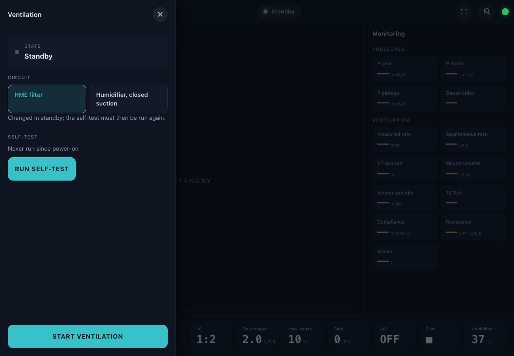</p>

<p align="center">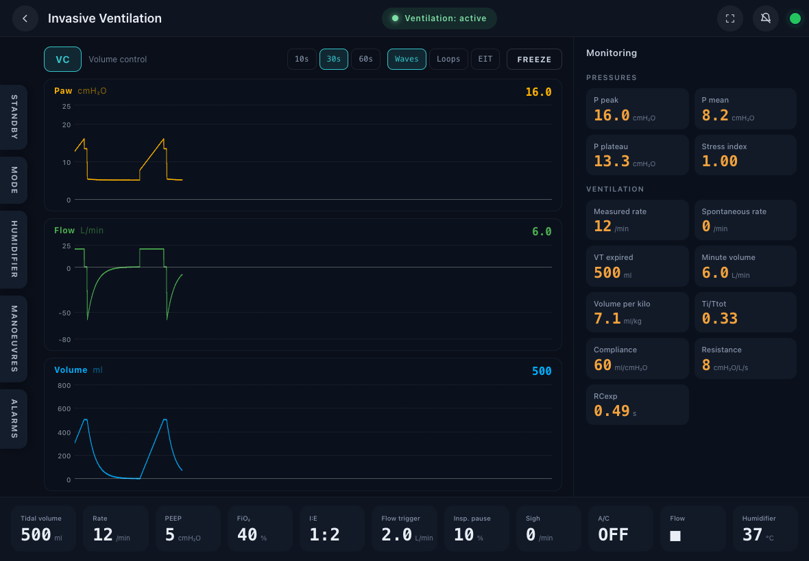</p>

From now on you see it on the console, waveforms included, and each action appears in the log on the right.

## 5. Using it on your own

Open the app and choose **On my own**, or open the simulator in a browser and click **Use without instructor**. Without an instructor, the patient screen shows an **Exercise settings** box (lung picture and teaching traces) to set up the case yourself. The start screen has a **Guided tour** button that walks a learner through their first ventilation.

<p align="center">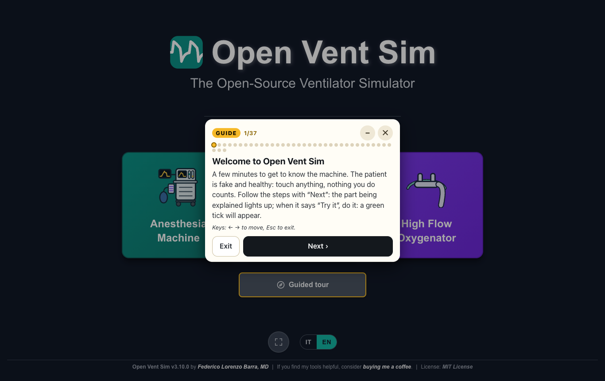</p>

**← Change mode**, top left on the start screen, goes back to the choice between Instructor, Ventilator and On my own.

The anaesthesia machine starts in **volume control**, in standby; **Manual** (bag) is in the ON/OFF drawer, with Paw, flow and CO₂.

<p align="center">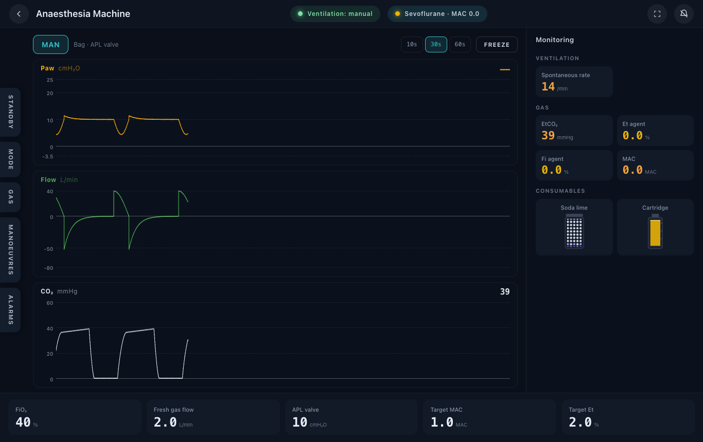</p>

### Settings, alarms and sounds

- **Changing a setting**: tap a box at the bottom. A tape appears above the row: drag it, or use − and +, the wheel or the arrow keys. While **yellow** the value is not active yet. Confirm with **✓**, a second tap on the box or Enter; tapping outside, Esc or 6 seconds without confirming keep the old one. From the console the change is immediate.
- **Alarms**: for each measurement the **red** limits are above the bar and the **yellow** ones below. Drag a tab, or tap it and use − and +. Red pushes yellow. The white mark is the value now, the shade its range over the last two minutes. **↺** puts one row back to its start-up values, **Reset all** every row.
- **Sounds**: the breath is synthesised from the flow waveform, so it follows timing, holds, cough and asynchronies. Red and yellow sound different. The two volumes are at the bottom of the Alarms panel; the bell silences the alarms, not the breath. Sound starts at the first touch on the screen.

<p align="center">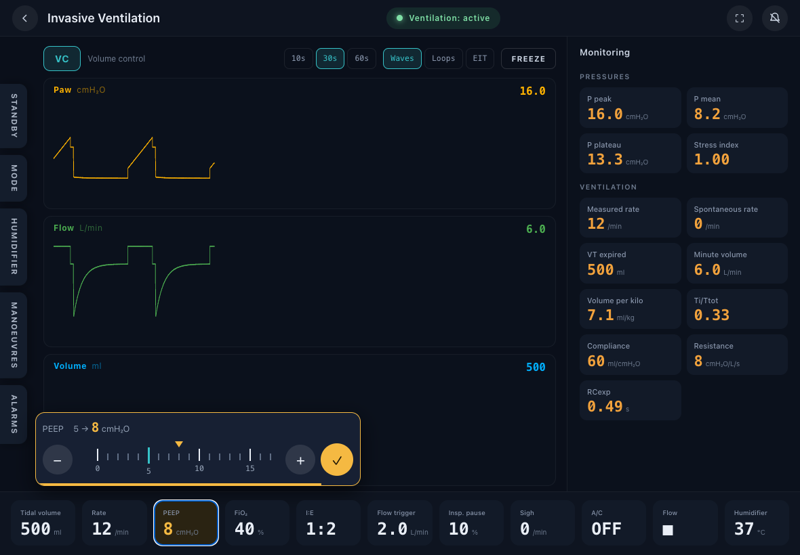</p>
<p align="center">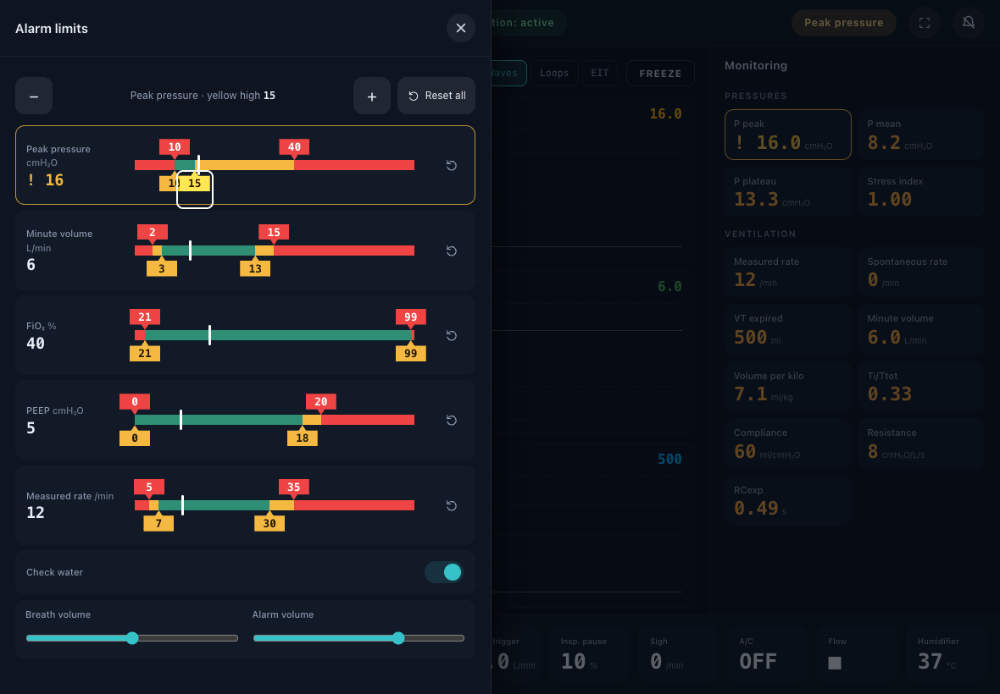</p>

### Waves, loops and hidden pressures

Above the waveforms there are the **Waves / Loops** buttons and, when enabled, **Palv·Pmus**:

- **Waves / Loops**: "Loops" shows the **pressure–volume** and **flow–volume** loops of the last breath. White is the breath in progress, the two before are fainter. **Keep as reference** freezes the current loop in grey: change PEEP or volume and compare.
- **Palv·Pmus** (off by default: real ventilators don't have it). The instructor enables it in the *Machine* tab, or a learner on their own ticks "Show the teaching traces" on the patient screen. It adds two traces. **Palv** is the pressure in the alveoli (Paw minus the resistive drop): it shows auto-PEEP before you measure it. **Pmus** is the patient's effort: it tells *when* they pull relative to the machine, which is how asynchronies are read.

<p align="center">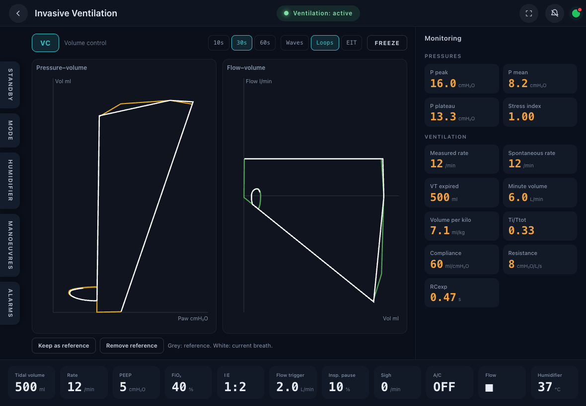</p>
<p align="center">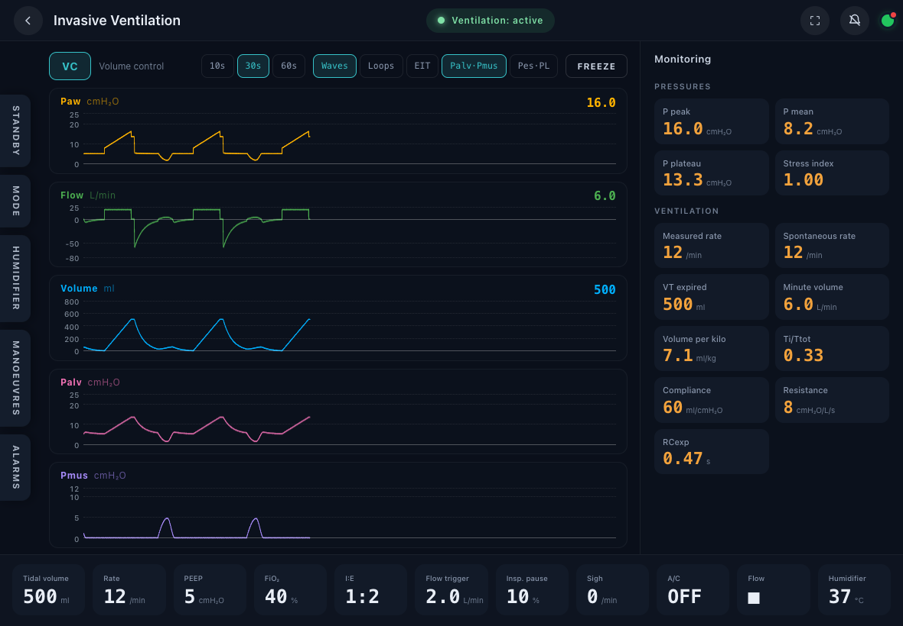</p>

**PRVC** (pressure-regulated volume control), in invasive ICU: you set the volume; the machine starts with a 10 cmH₂O test breath and changes the pressure by at most 3 cmH₂O per breath until the volume is reached. If compliance falls, pressure rises by itself — which is the point to teach. The regulator reads the breaths actually delivered: if the patient pulls, the machine lowers the pressure.

### The breathing engine, EIT and the new manoeuvres (3.2)

The waveforms come from a **breathing engine**: the equation of motion integrated at 200 Hz, with the patient's effort inside. Auto-PEEP builds up breath by breath, an ineffective effort is a real effort that misses the trigger, a double trigger is an effort longer than the machine's inspiration. The engine was validated against the simulator by T. Piraino (sim.rtmaven.com, reviewed by G. Bellani): tidal volumes within 1–2%, pressures within 0.5 cmH₂O (comparison in `docs/confronto-rtmaven.md`).

- **PAV+** and **A/C** (trigger open in VC, PC, PRVC; off by default). **Decelerating flow** in VC.
- **NEURO** (neural assist), invasive and NIV, once the console has mounted the EAdi catheter: Paw = PEEP + level × EAdi. In NIV also **PC** (time-cycled, always assisted) and a choice for a **leak over 95%** (keep ventilating, or pause).
- **Pes·PL**: oesophageal and transpulmonary pressure, with the cardiac artefact.
- **P0.1** (when the patient opens the breaths) and **stress index** (VC, square flow) on the display.
- **EIT** (invasive ICU): tidal and dynamic image, global/ventral/dorsal impedance, pendelluft with vigorous efforts, and a **PEEP trial** with collapse/overdistension curves and their crossing (Costa 2009).
- **Manoeuvres**: the expiratory hold becomes an **occlusion test** when the patient pulls (ΔPocc, estimated Pmus and dynamic PL); **low-flow P/V curve** finds the airway opening pressure; **R/I ratio** (Chen 2020) from PEEP ≥ 10.
- In the instructor console, the **Effort & chest wall** tab: obesity, tense abdomen, airway closure, vigorous effort, irregular breathing, cardiac oscillations, grunting, active expiration; effort shape, effort that responds to support, breath-to-breath variability. The **Machine** tab saves and loads a **scenario** (patient and machine) as a file.

| Anaesthesia | Non-invasive | High flow |
|---|---|---|
| 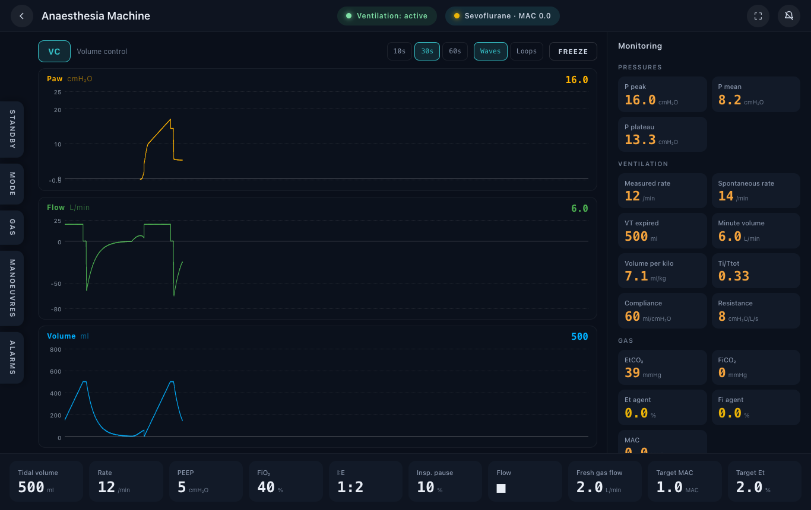 | 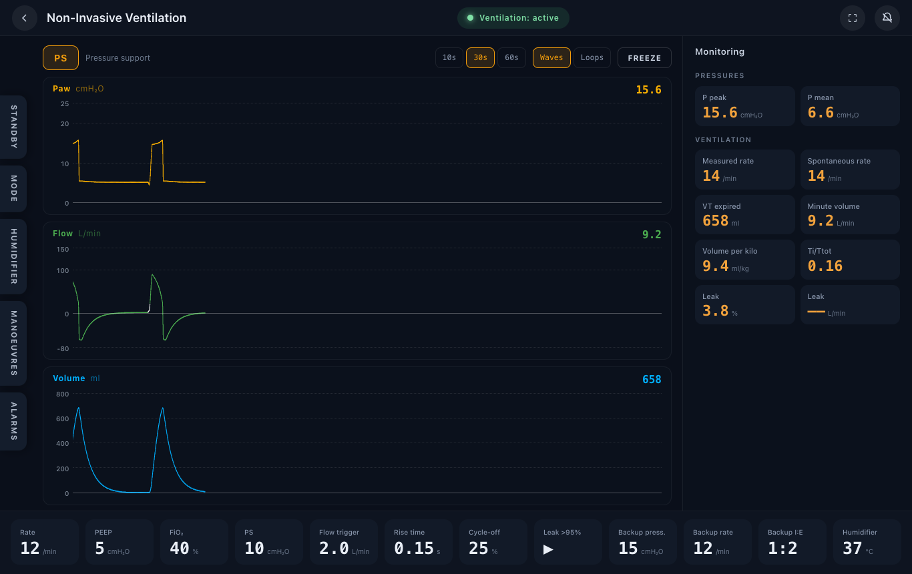 | 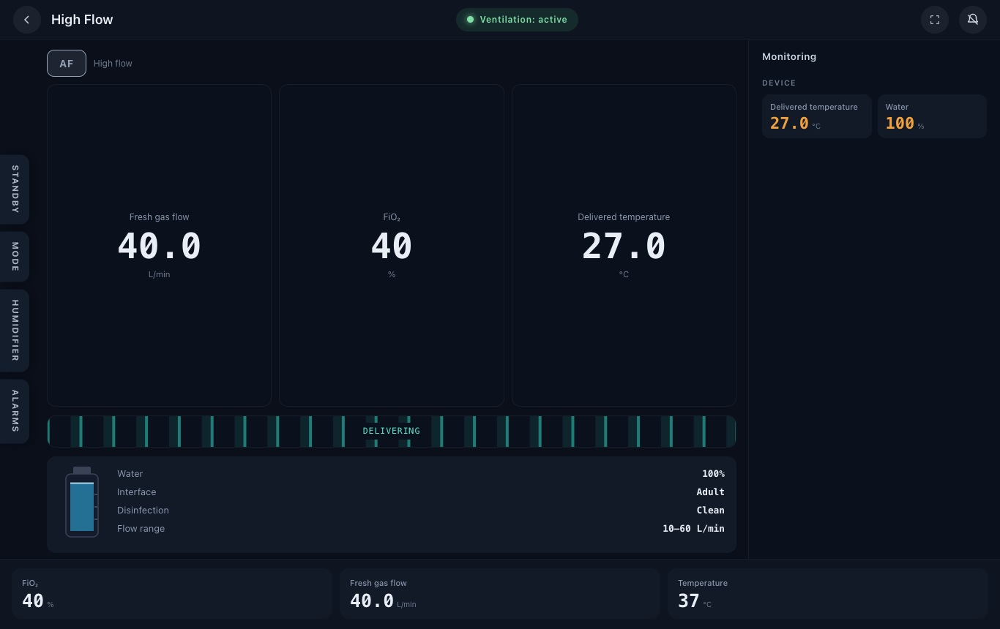 |

## 6. The instructor console in detail

At the top choose **where commands go**: *this ventilator* (selected on the left) or *all ventilators*.

| Tab | What you do |
|---|---|
| **Patient** | One-click clinical pictures (Normal, COPD, ARDS, COVID, Anaphylaxis, Pulmonary oedema, Pneumonia, Fibroscopy); **cases from the literature**, ready to load, each with what the learner should find and its reference; compliance, resistance, effort, secretions; SpO₂, EtCO₂, heart rate, mean arterial pressure. With **"Change over"** the change happens gradually (30 s – 5 min) instead of at once. |
| **Asynchronies** | Ineffective effort, double cycling, reverse triggering, flow starvation, premature/delayed cycling, auto-triggering, with the share of breaths affected. Learners only see the **waveforms**, never the name: spotting it is their job. Below, **Single cough** and **Coughing fit**: Paw to the high limit and the pressure alarm. |
| **Lung** | Three behaviours with PEEP: **Non-recruitable**, **Recruitable**, **Unstable** (opens at high PEEP, derecruits as soon as it comes down). Live compliance and driving pressure. Start the **recruitment manoeuvre**. Under *Fine tuning*: recruitability, chest-wall compliance, margin before derecruitment, overdistension PEEP. |
| **Gas exchange** | One-click **pictures** that add up: pulmonary embolism, consolidation, anaemia, fever, sepsis, metabolic acidosis, CO poisoning, methaemoglobinaemia, inhaled NO; **one-lung ventilation**. Nine live numbers for the instructor (the ventilator does not show them): pH, PaCO₂, PaO₂, P/F, Qs/Qt, SaO₂, alveolar VD/VT, PaCO₂ − EtCO₂, EtCO₂/PaCO₂ (Bohr-Enghoff, Cipulli 2026, see `docs/spazio-morto.md`). *All values* opens the rest of the blood gas and the dead space indices; *Fine tuning* the sliders (shunt, low V/Q, dead space, diffusion, Hb, temperature, metabolism, bicarbonate, cardiac output, BMI, vasodilators, NO, CO, MetHb). |
| **Machine** | Mode, settings, start/standby, silence alarms, inspiratory and expiratory holds: applied as if the learner touched them (logged as instructor actions). |
| **Effort & chest wall** | Pictures that add to the lung (obesity, tense abdomen, airway closure, vigorous effort…), the shape of the effort, an effort that responds to support; in NIV the **mask leak**; in high flow the **cannula** (blocked, tube detached, out of the nose), **mouth open** and the **ROX** index for the instructor. |
| **Diaphragm** | Mount the **EAdi catheter** (in place, too deep, too shallow, dislodged: a real depth the learner then corrects), neuromechanical efficiency, phrenic lesion, sedation and curare. Without the catheter NEURO is greyed out on the ventilator. |
| **Alarms** | The ventilator's alarm limits (red and yellow thresholds, on/off), as in its own Alarms drawer; ↺ puts one row back to its start-up values, **Reset to the start-up limits**. In PS, CPAP and PAV there is the **apnoea** time (default 20 s). |
| **Events** | Ready-made events (bronchospasm, mucus plug, pneumothorax, desaturation, hypercapnia, induction, waking up, NMB reversal…). Fire now or build a timed **sequence**; save it to a file for next time. |

<p align="center">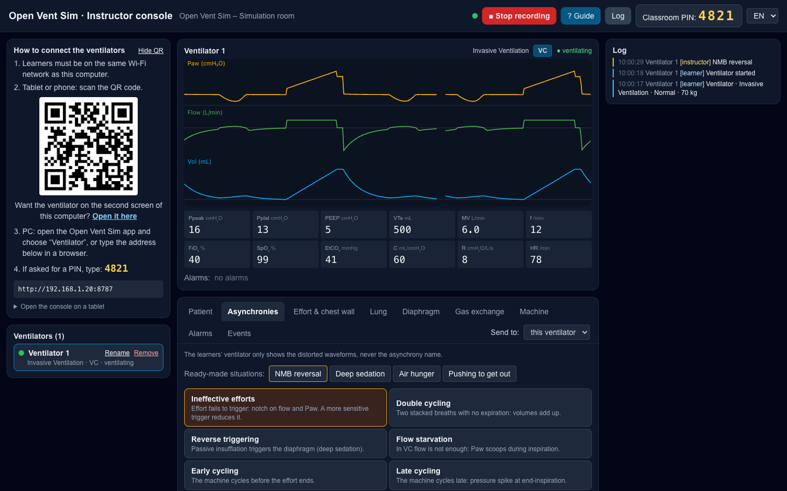</p>

<p align="center">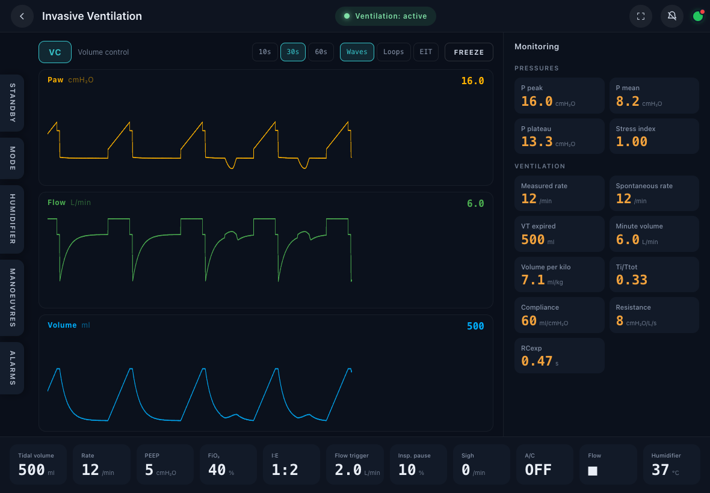</p>

<p align="center">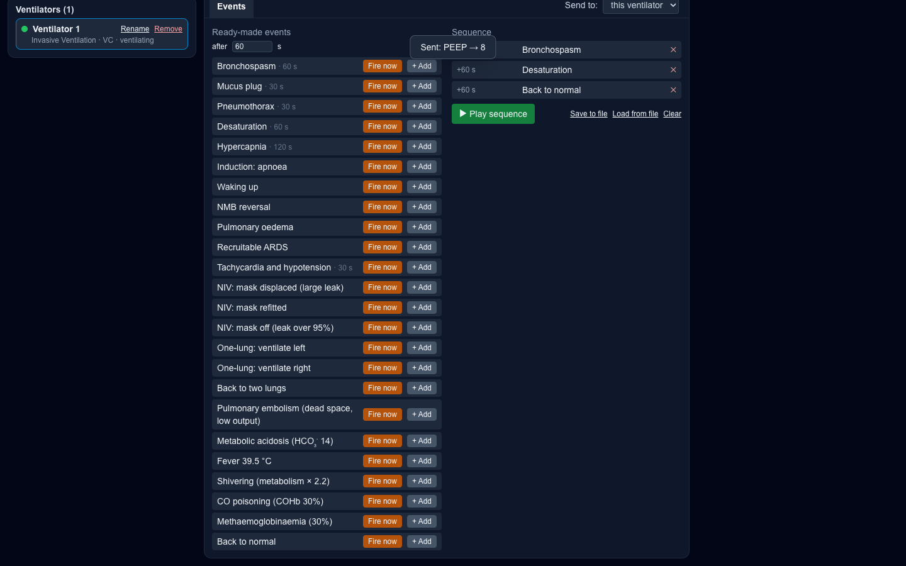</p>

<p align="center">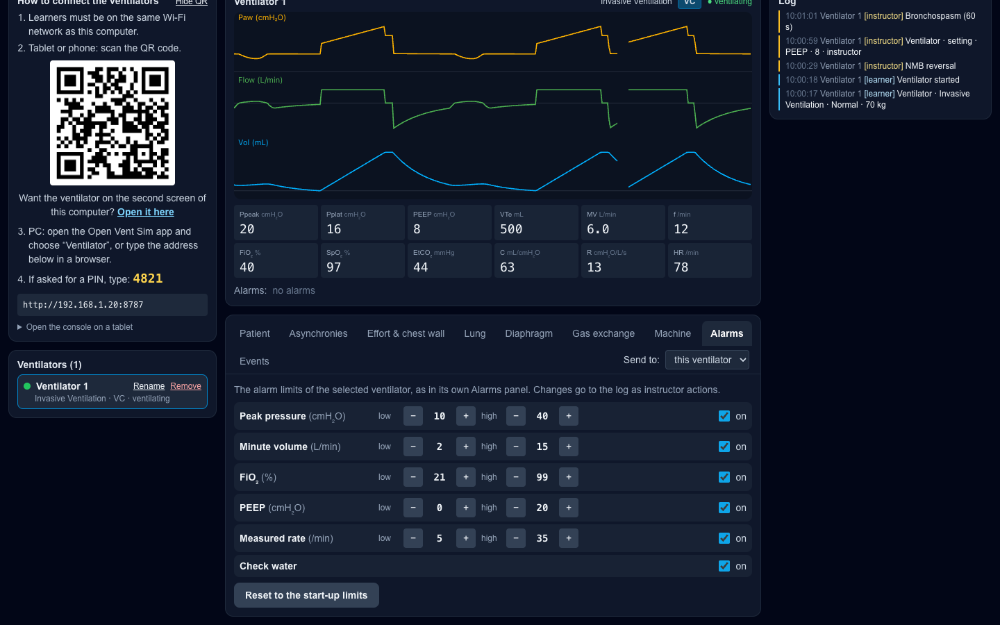</p>

**Console on a tablet.** In the left panel open "Open the console on a tablet" and scan the QR with **your** tablet to walk around the room with the console in hand. Don't show it to learners: it gives full control.

## 7. The session log

1. On the console press **● Record session**. Learners' ventilators show **● REC**.
2. Run the class.
3. Press **■ Stop recording**: the log opens.

<p align="center">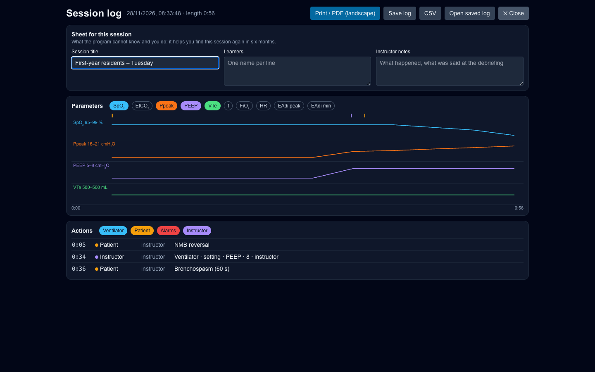</p>

- **Session sheet**: title, learners' names, debriefing notes.
- **Parameters**: SpO₂, EtCO₂, Ppeak, PEEP, VTe, rate, FiO₂ and HR over time. Toggle the coloured pills; ticks at the top mark the actions.
- **Actions**: minute by minute (0:00 = start of recording), grouped as *Ventilator*, *Patient*, *Alarms* and *Instructor*. Several turns of the same knob within a minute become one line; click it to expand.
- **Print / PDF**, **Save log** (`.json`, reopen later with "Open saved log") and **CSV** for Excel.

The log survives closing and reopening the console.

## 8. Troubleshooting

| Problem | Fix |
|---|---|
| Learner **can't find the instructor** or the QR doesn't open | Check they're on the **same Wi-Fi** (not the "guest" network). On Windows you must have clicked **Allow access** the first time (§3); if you denied it: *Control Panel → Windows Defender Firewall → Allow an app* → tick Open Vent Sim. |
| Works on a PC but not on phones | The Wi-Fi isolates devices ("client isolation"), common in hospitals. Use your own router or a **phone hotspot** and connect everyone to it, console included. |
| "Wrong PIN" | The PIN changes at every start of the console: use the one shown now, top right. |
| The top-right dot turns **orange** and says "Network lost – reconnecting…" | Do nothing: it reconnects by itself when the network is back, and the ventilator keeps running. |
| "Opened in another window" | The same ventilator is open in two tabs: close one. |
| The address changed since last time | Normal, it depends on the router. Always use what the console shows **today**. |
| Port 8787 is busy | The console moves to the next one (8788, 8789…) by itself: the right address is always the one on screen. |
| Mac says the app is "damaged" | Open Terminal, type `xattr -cr "/Applications/Open Vent Sim.app"`, then reopen. |
| I want the old (2.x) interface | In the browser, add `?legacy=1` to the address (stand-alone only). |

## 9. What's new

### 3.10.0 — 28 November 2026

- **Reference lines on the waveforms**, as on ICU ventilators: zero as a solid line, the scale numbered on the left, a few round values dotted, in neutral grey. You can see whether flow gets back to zero before the next breath.
- **The scale follows the patient**: it stays still while the trace is drawn and is recalculated at each sweep on what the curve actually did. If the curve goes off scale it widens at once instead of being clipped flat.
- **A confirmed setting starts from the next breath**: the breath in progress ends as it began, so the trace no longer breaks when you change the rate, the volume or the mode.

### 3.9.1 — 25 November 2026

- **Updates you don't miss**: checked at start, every few hours and when the network is back. The first screen shows the installed version, what's new and **Check for updates**; on the console only a small badge, never a dialog over the lesson.

### 3.9.0 — 25 November 2026

- **Yellow and red alarms**: each measurement has red and yellow limits to drag with a finger, with the value now and its range over the last two minutes. ↺ per row and a general reset. The yellow ones start preset and wide; sessions saved earlier stay valid.
- **Settings are confirmed**: they are adjusted on a tape above the bar, and the value stays yellow until you confirm it with ✓. Without confirming, after 6 seconds the old one stays. From the console the change is still immediate.
- **You can hear the breath**: airflow and valves synthesised from the flow waveform, in step with Ti, holds, cough and asynchronies. Different alarm sounds for yellow and red, separate volumes. Silence stops the alarms, not the breath.
- The console's **Alarms** tab also moves the yellow limits; the log shows the severity, and going from yellow to red is a line.

### 3.8.2 — 21 November 2026

- The first screen of the desktop app (Instructor, Ventilator, On my own) has illustrated icons like the machine tiles, aligned at the top.
- The README video opens in a page that plays it.

### 3.8.1 — 21 November 2026

- **New icons**: the machines, the airway (endotracheal tube, NIV mask, high-flow cannula) and the small controls are redrawn so they read as what they are, at any size.
- **One mark** for the app: two pressure-support breaths of the flow curve, white on teal. It replaces the lung emoji in the title and the blue icon on the desktop.
- **Languages as text** (IT · EN) instead of flag emoji, which Windows does not show.

### 3.8.0 — 21 November 2026

**Neural assist (NEURO) and the diaphragm signal (EAdi).**
- The console mounts an **EAdi catheter** (new *Diaphragm* tab). The diaphragm's electrical activity comes from the patient's own effort through the neuromechanical efficiency (Bellani, Crit Care Med 2013); sedation, curare and a phrenic lesion change it, and a misplaced catheter shows as it does at the bedside (ECG in the signal, high minimum, expiratory muscles).
- **NEURO**, invasive and NIV: Paw = PEEP + level × EAdi, neural trigger racing the pneumatic one, cycling at 70% of the EAdi peak, a ceiling 5 cmH₂O under the high pressure limit, backup, automatic fallback to pressure support («NEURO ⇄ PS») and the **EAdi signal not credible** alarm. NEURO is greyed out until the catheter is mounted; the EAdi lane and numbers appear only in NEURO.
- **Titration with a knee**: raising the level, VT stops around 6.5 ml/kg (Hering-Breuer) while EAdi keeps falling (Brander, Chest 2009).
- **The learner places the catheter**: starting depth from NEX (× 0.9 nasal, × 0.8 oral, plus the caliber constant), four live oesophageal ECG leads with the diaphragm lighting where it is strongest, push or pull one electrode step at a time, check with an expiratory occlusion (EAdi up, Paw down at the same moment). The rule gets close, not always on target (Barwing, Intensive Care Med 2009).

**NIV.** Pressure control (time-cycled, always assisted: its Ti does not drag with a leak); NEURO through the mask, with trigger and cycling the leak cannot touch (Bertrand, Chest 2013); **leak over 95%**: keep ventilating or pause with a high or low flow, resume by itself, **Excessive leak** alarm; console event *mask off*.

**High flow.** The panel shows the **measured** flow and a band that moves while it delivers. Cannula faults from the console: blocked (**Flow obstructed**), tube detached (**Circuit open**), out of the nose (nothing sounds: the patient desaturates). **Mouth open** lowers the pressure the flow makes. The **ROX** index on the console (Roca, AJRCCM 2019).

**Five new ready cases**: NEURO titration; COPD on NIV with a leaking mask; high flow with the cannula out of the nose; the catheter at the NEX depth; difficult weaning with a high EAdi (Doorduin, Anesthesiology 2018).

**From 3.7** (not released on its own): pressure control on a real machine (regulator overshoot, expiratory-valve relief, double cycling in pressure modes, active expiration versus cough), the *Pushing to get out* situation and the *PC with long Ti and air hunger* case (de Haro 2019); several asynchronies at once on the same patient, anchored on the patient's efforts in A/C; the measured peak pressure in pressure modes.

**Fixes.** In PAV and NEURO the displayed peak pressure was PEEP + 1.5 instead of the measured one. The guided tour picks up steps that start to apply when the mode changes.

The **guided tours** of the ventilator and the console cover all of the above.

### 3.6.0 — 17 November 2026

**CO₂ and dead space**, aligned with Cipulli F et al., *Dead space in critical care: a practical approach with clinical scenarios*, J Anesth Analg Crit Care 2026;6:20 (`docs/spazio-morto.md`).
- **Shunt touches CO₂**: PaCO₂ is alveolar CO₂ mixed with venous blood through the shunt, so the Enghoff dead space is overestimated above 40% shunt, as at the bedside.
- **PaCO₂ − EtCO₂** at rest about 5 mmHg; **trapped CO₂** with auto-PEEP, with EtCO₂ above PaCO₂ (negative dead space); a **shark-fin capnogram** with obstruction.
- **Airway dead space grows with PEEP** (about 3 ml per cmH₂O at 70 kg; Tusman, Respir Care 2019).
- Indices: alveolar, physiological and anatomical VD/VT, EtCO₂/PaCO₂, ventilatory ratio, standardised VE.

**A simpler console.**
- **Cases from the literature** (Patient tab): H1N1 influenza ARDS, pneumococcal ARDS, COVID-19 with decremental PEEP. One click sets patient, gas exchange and machine; below appear what the learner should find and the reference, paper and case.
- **Lung**: three behaviours (Non-recruitable, Recruitable, Unstable) instead of sliders. Two new patient properties under *Fine tuning*: the **margin before derecruitment** (how far PEEP can drop below the level the lung was recruited at before it closes again) and the **overdistension PEEP** (where overdistension halves compliance).
- **Gas exchange**: one-click pictures, nine numbers in view, the rest under *All values* and *Fine tuning*.
- The **guided tour** of the console explains the cases, the lung behaviours and the gas exchange pictures.

### 3.5.0 — 14 November 2026

**Gas exchange.** SpO₂ and EtCO₂ are no longer written numbers: they come from the patient.
- **CO₂**: production from weight, temperature and metabolism; anatomical, apparatus (HME, mask) and alveolar dead space; alveolar ventilation counted on the delivered breaths, so rapid shallow breathing raises CO₂ even at the same minute volume. Two stores (blood and tissues): in apnoea PaCO₂ rises about 10 mmHg in the first minute, then 3–4 per minute. EtCO₂ separates from PaCO₂ with alveolar dead space (embolism, overdistension, low output).
- **Acid-base**: pH from Henderson-Hasselbalch, acute buffering, slow renal compensation, BE, lactate when O₂ delivery falls short.
- **Oxygenation**: three compartments (ideal, low V/Q, shunt) fed by the sliced EIT lung. Shunt does not respond to FiO₂, low V/Q does; PEEP reduces shunt only if the lung is recruitable. Diffusion along the capillary: with a reduced capacity, desaturation appears as output and consumption rise. Contents, mixed venous blood, dissociation curve shifted by pH, temperature and CO₂.
- **Hypoxic pulmonary vasoconstriction** in two phases (minutes and tens of minutes), blunted by volatile agents above 1 MAC, vasodilators and alkalosis; **inhaled NO** shifts flow towards the ventilated lung.
- **One-lung ventilation** from the console: compliance halved, shunt from the excluded lung, SpO₂ that falls and then recovers by itself as vasoconstriction works.
- **O₂ stores and apnoea**: FRC (weight, BMI, PEEP, collapse) and venous blood. A pre-oxygenated adult lasts about 7 minutes to 90%, on air less than one, an obese patient much less; apnoeic oxygenation through an open airway holds saturation while CO₂ rises.
- **Recruitment hysteresis**: after a recruitment the lung stays open until PEEP drops below the closing pressure; with high FiO₂ and low PEEP absorption atelectasis appears. The same state moves compliance, EIT and shunt.
- **CO and methaemoglobin**: a pulse oximeter that is wrong the way real ones are (near-normal SpO₂ with CO, towards 85% with methaemoglobin).
- **Calibration on scenarios**: the written SpO₂ and EtCO₂ stay the targets; when they change the model recalibrates within half a minute, and from there adds the consequences of actions (FiO₂, PEEP, standby, recruitment).
- **Console**: *Gas exchange* tab, live arterial blood gas as a reference for the instructor, new events (one-lung, embolism, metabolic acidosis, fever, shivering, CO, methaemoglobin). A saved scenario carries the gas exchange parameters.

Four new indices, read on the engine's own curves:
- **RSBI** (f/VT, Yang and Tobin) in PS, CPAP and PAV, only while the patient breathes (blank on apnoea backup breaths). Above 105, weaning tends to fail.
- **Flow index** in PS (Albani, *Crit Care* 2021): the exponent of `Q = a + b·tᶜ` from peak inspiratory flow to cycling. One is a linear fall; it rises with effort and falls as support goes up. The simulator's range is narrower than in patients (≈1 passive, ≈2 strong effort): read the direction, not the clinical cut-offs 2.6 and 4.5.
- **RCexp**, the expiratory time constant measured at 75% of the exhaled volume (volume left / flow): R·C in a normal lung, longer when obstructed.
- **PMI** on the inspiratory hold in PS (Foti 2009): Pplat − (PEEP + PS). Above zero the diaphragm added volume too.

### 3.4.1 — 13 November 2026

- **Dynamic compliance** on patient-triggered breaths, marked with an asterisk: VTi / (Ppeak − PEEP), as ventilators compute it. The volume made by the diaphragm counts while only the machine's pressure does, so a patient pulling hard on low PS reads a falsely high compliance (PS 5, PEEP 8, true C 40, strong effort → 90*). The true compliance comes from the inspiratory hold; P0.1 and Pocc show the drive.

### 3.4.0 — 11 November 2026

- **Cough on the machine** from the console (*Asynchronies* tab): **Single cough** or **Coughing fit** (four coughs in a row, each weaker). Paw rises to the high peak-pressure limit, the machine stops the insufflation, the pressure alarm sounds; a sharp expiratory flow, then the lung refills.

### 3.3.0 — 10 November 2026

From the first classroom test:
- **One machine, several screens**: a device that joins while a ventilator is on shows that same machine and drives it; **Detach** for a separate ventilator, **Carry on from here** if the main screen disconnects. The console shows "▣ +1" next to a ventilator shown on other screens.
- **Apnoea alarm** with a time limit (PS, CPAP, PAV), also while backup ventilation runs. An apnoeic patient in CPAP now reads rate 0.
- **Alarms** tab in the console: change the limits remotely, or reset them to the start-up ones.
- **Flow** waveform in manual (bag) ventilation, including the breaths given by hand.
- The anaesthesia machine starts in volume control and no longer alarms for Et agent while the vaporizer is closed.
- The machine's first drawer reads **ON/OFF** when it is off.
- **Change mode** from the stand-alone start screen; **Open it here** for the second screen, under the QR code.
- **Updates from GitHub** at every start (automatic with the Windows installer, download link on Mac and portable).

### 3.2.0 — 9 November 2026

- Breathing engine (equation of motion, deterministic for the classroom network), validated against sim.rtmaven.com.
- PAV+, A/C, decelerating flow, Pes·PL, P0.1, stress index, EIT with PEEP trial and pendelluft.
- Occlusion test, low-flow P/V curve (airway opening pressure), R/I ratio.
- Console: *Effort & chest wall* tab, scenario save/load. PRVC reads the delivered breaths.
- NIV: the console sets a **real mask leak** (l/min): VTi above VTe, delayed cycling, auto-triggering, pressure not reached with the mask off the face. New *Leak* reading in l/min.
- **Ventilator on the second screen**: one button in the console opens a ventilator, already joined, full screen on the projector or interactive whiteboard (Esc leaves full screen). Learners still need nothing installed: any browser on the same network (iPad included) opens the ventilator from the QR code or the address and PIN.
- Guided tour: steps for every new function.

### 3.1.3 — 8 November 2026

- The footer shows the real app version (it always said 2.0.0).
- Removed start-screen buttons that did nothing (recording, settings, manual): recording is started from the instructor console.
- The connection status is a dot in the top-right corner and no longer covers the footer or the settings bar.

### 3.1.2 — 8 November 2026

- A learner linked to the console only enters weight and age: lung picture and teaching traces are the instructor's call. On your own they are still there, set apart as "Exercise settings".

### 3.1.1 — 8 November 2026

- Settings bar: long names ("Inspiratory pause") no longer wrap; the tile shows the short name, the full one is in the tooltip.

### 3.1 — 8 November 2026

- **Loops**: pressure–volume and flow–volume, with a reference loop to compare.
- **Palv** (alveolar pressure) and **Pmus** (patient effort) traces.
- **PRVC** mode in invasive ICU.
- Fixed: a patient who resumes breathing at the same rate as the machine (NMB reversal) now shows the efforts on the waveforms.

### 3.0 — 8 November 2026

- **Instructor console over the local network**: built-in server, QR, PIN, automatic discovery, automatic reconnection, many ventilators at once, console on a tablet.
- **New screens and engine**: one layout for anaesthesia, invasive ICU and NIV, plus high flow. PEEP-dependent compliance, auto-PEEP, patient effort and seven asynchronies, recruitment manoeuvre, consumables, humidifier.
- **Session log** started from the console, printable to PDF.
- **Guided tour** (familiarisation), English and Italian.
- **Desktop app** for Windows and Mac; works **offline** (React and Tailwind used to come from external CDNs).
- Redesigned start screen with original icons.
- Language follows the system and is remembered.

## 10. For developers

```bash
git clone https://github.com/fedebarra/open-vent-sim.git
cd open-vent-sim
npm install
npm run dev            # development, http://localhost:3000 (simulator only)
npm run server         # build + classroom server on the LAN (port 8787)
npm run desktop        # Electron app
npm test               # unit + server tests
npm run test:e2e       # end-to-end (console + learners in two browsers)
npm run screenshots    # regenerate every image in this README
npm run dist:mac       # .dmg installer   (npm run dist:win for Windows)
```

- `device/`: ventilator engine and screens (Italian names kept on purpose).
- `remote/`: console, link, session log. `server/ovs-server.mjs`: HTTP + WebSocket server and UDP beacon on the LAN. `electron/`: desktop app. `tour/`: guided tour.
- Releases build themselves on GitHub Actions when a `v*` tag is pushed.

**Development requires** Node.js 20 or later.

---

## 11. How to cite

If you use Open Vent Sim in a course, a thesis, a poster or a paper, please cite the article that describes it:

> Barra FL, Ricci S, Moro E, Travěnec J, Costa A, Carenzo L, Rodella G, Vaschetto R. *Simulator development using natural language: clinician-led innovation through artificial intelligence.* Advances in Simulation. 2026;11(1). [doi:10.1186/s41077-026-00467-2](https://doi.org/10.1186/s41077-026-00467-2)

```bibtex
@article{barra2026openventsim,
  author  = {Barra, Federico Lorenzo and Ricci, Serena and Moro, Edoardo and Trav{\v{e}}nec, Ji{\v{r}}{\'i} and Costa, Alessandro and Carenzo, Luca and Rodella, Giovanna and Vaschetto, Rosanna},
  title   = {Simulator development using natural language: clinician-led innovation through artificial intelligence},
  journal = {Advances in Simulation},
  year    = {2026},
  volume  = {11},
  number  = {1},
  doi     = {10.1186/s41077-026-00467-2}
}
```

On GitHub the same reference is behind the **“Cite this repository”** button (file `CITATION.cff`).

---

### Acknowledgements

Developed at Università del Piemonte Orientale, Novara, Italy. Clinical team: F.L. Barra MD, E. Moro MD, L. Carenzo MD, A. Costa MD, G. Rodella RN, R. Vaschetto MD PhD. Technical facilitators: S. Ricci PhD, J. Travenec MSc. Thanks to all the Anaesthesiology residents who gave feedback.

**Images for slides and articles:** [`docs/press/`](docs/press) holds high-resolution screenshots (2880×1800) in English and Italian, free to use under the project licence.

**Support:** [Issues](https://github.com/fedebarra/open-vent-sim/issues) · federico.barra@med.uniupo.it

**Licence:** MIT. Icons are original drawings made for this project.
