# Open Vent Sim 3.2

**A free, open-source simulator of ICU ventilator, anaesthesia machine and high-flow oxygen — with an instructor console that runs on your classroom's own network.**

🇮🇹 [Versione italiana](README.it.md) · 📅 Version 3.2.0 — 9 November 2026 · MIT licence

📄 **The paper:** [*Simulator development using natural language: clinician-led innovation through artificial intelligence*](https://doi.org/10.1186/s41077-026-00467-2), Advances in Simulation 2026. If you use Open Vent Sim in a course, a thesis or a paper, [please cite it](#11-how-to-cite).

<p align="center">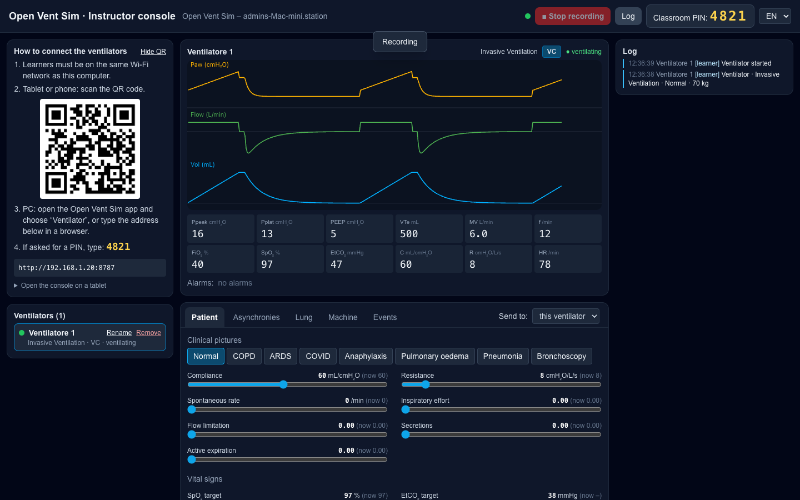</p>

> ⚠️ **For education only.** Not a medical device. Never use it for clinical decisions.

---

## Contents

1. [What it does](#1-what-it-does)
2. [What you need](#2-what-you-need)
3. [Download and install (5 minutes)](#3-download-and-install)
4. [Running a class, step by step](#4-running-a-class-step-by-step)
5. [Using it on your own](#5-using-it-on-your-own)
6. [The instructor console in detail](#6-the-instructor-console-in-detail)
7. [The session log](#7-the-session-log)
8. [Troubleshooting](#8-troubleshooting)
9. [What's new](#9-whats-new)
10. [For developers](#10-for-developers)
11. [How to cite](#11-how-to-cite)

---

## 1. What it does

- **Three machines in one**: anaesthesia workstation, ICU ventilator (invasive and non-invasive) and high-flow oxygen.
- **Real waveforms**: pressure, flow and volume come from a lung model with PEEP-dependent compliance, auto-PEEP, patient effort and asynchronies.
- **Pressure–volume and flow–volume loops**, **alveolar pressure (Palv)** and **patient effort (Pmus)** traces, **PRVC** mode.
- A **breathing engine** that integrates the equation of motion: auto-PEEP, triggers, cycling and asynchronies happen instead of being drawn. **PAV+**, assist-control (A/C), **decelerating flow**, **Pes and PL** traces, **P0.1** and **stress index**, **EIT** with PEEP trial and pendelluft, **low-flow P/V curve** (airway opening pressure), **R/I ratio**, the **occlusion test**.
- **Instructor console**: from one computer (or tablet) you see every learner's ventilator live and change the patient: clinical picture, mechanics, vital signs, asynchronies, timed events.
- **Session log** for the debriefing: who did what and when, with parameter trends. Prints to PDF.
- **Guided tour** for people who have never touched a ventilator.
- **No internet, no accounts**: it runs on your room's local network. No data leaves the room.
- English and Italian.

## 2. What you need

| Who | What |
|---|---|
| **Instructor** | A **Windows 10/11** or **Mac** (macOS 11 or later) computer. |
| **Learners** | A Windows/Mac computer with the app, **or** any tablet/phone with a browser (Safari, Chrome…). Nothing to install on tablets. |
| **Network** | Everyone on the **same Wi-Fi** (or the same router). Internet is **not** needed. |

> 💡 Many hospital and university Wi-Fi networks **isolate devices** from each other, so the console cannot see the learners. If that happens, use a small router of your own or a phone hotspot (see [§8](#8-troubleshooting)).

## 3. Download and install

Go to **[Releases](https://github.com/fedebarra/open-vent-sim/releases/latest)** and download the right file:

| Your computer | File |
|---|---|
| Windows | `OpenVentSim-3.2.0-win-x64.exe` (installer) — or `OpenVentSim-3.2.0-portable.exe` (no install, just run it) |
| Mac with Apple chip (M1, M2, M3, M4…) | `OpenVentSim-3.2.0-mac-arm64.dmg` |
| Mac with Intel processor | `OpenVentSim-3.2.0-mac-x64.dmg` |

> If the `.dmg` won't open, download the `.zip` with the same name: double-click to extract, then drag **Open Vent Sim** into Applications.

> Not sure which Mac? Apple menu  → **About This Mac**. "Chip Apple M…" → `arm64`; "Processor Intel" → `x64`.

### Windows

1. Double-click the `.exe`.
2. A blue **"Windows protected your PC"** box appears: normal for free unsigned programs. Click **More info** → **Run anyway**.
3. Next, Next, Finish. **Open Vent Sim** is on your desktop.
4. **The first time you open the Instructor console**, Windows asks about network access: tick **Private networks** (and **Public** if the classroom network is marked public) and click **Allow access**. Without this, learners can't connect.

### Mac

1. Open the `.dmg` and **drag Open Vent Sim into Applications**.
2. Double-click it in Applications. macOS says it **cannot verify the developer**: click **Done** (not "Move to Bin").
3. Open **System Settings → Privacy & Security**, scroll down, click **Open Anyway** next to "Open Vent Sim was blocked", and confirm with your password.
4. From now on it opens normally. If asked to accept incoming connections, click **Allow**.

## 4. Running a class, step by step

### Instructor

**1.** Open Open Vent Sim and choose **Instructor**.

<p align="center">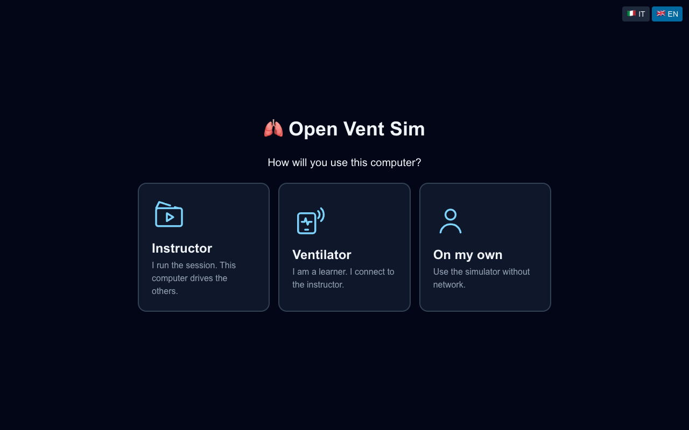</p>

**2.** The console opens. On the left is everything the learners need: **QR code**, **address** and the **4-digit PIN** (top right, in yellow). The PIN changes every time.

<p align="center">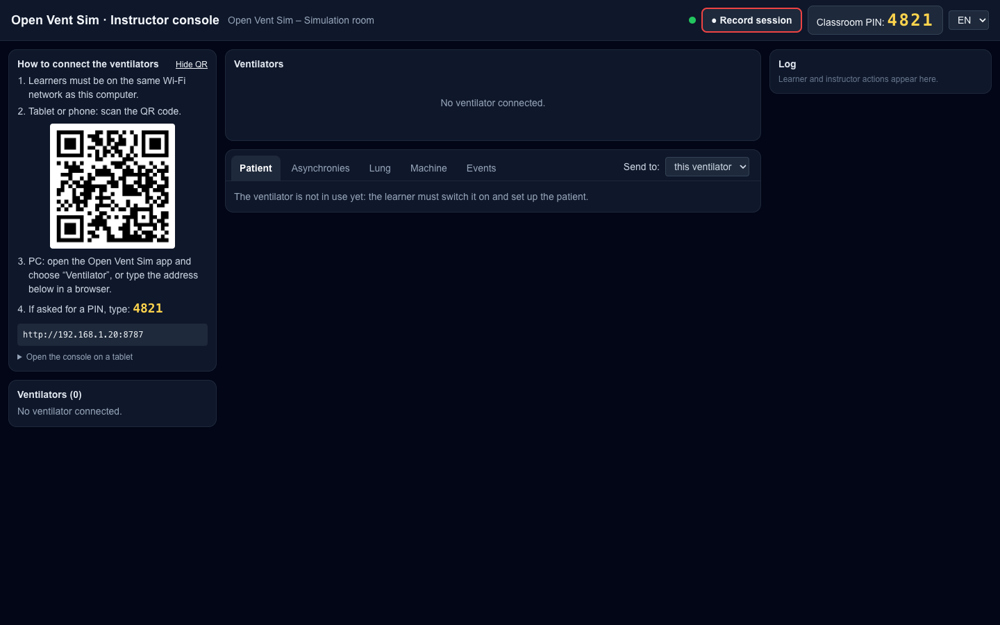</p>

Keep this window open for the whole class: **closing it disconnects the room**.

### Learners

Any of these works:

- **Tablet or phone** → scan the **QR code** with the camera. The simulator opens already connected.
- **PC with the app** → open Open Vent Sim, choose **Ventilator**, click the instructor that appears. If none appears, type the address shown on your screen (e.g. `192.168.1.20:8787`).
- **PC without the app** → type the address in a browser (e.g. `http://192.168.1.20:8787`).

<p align="center">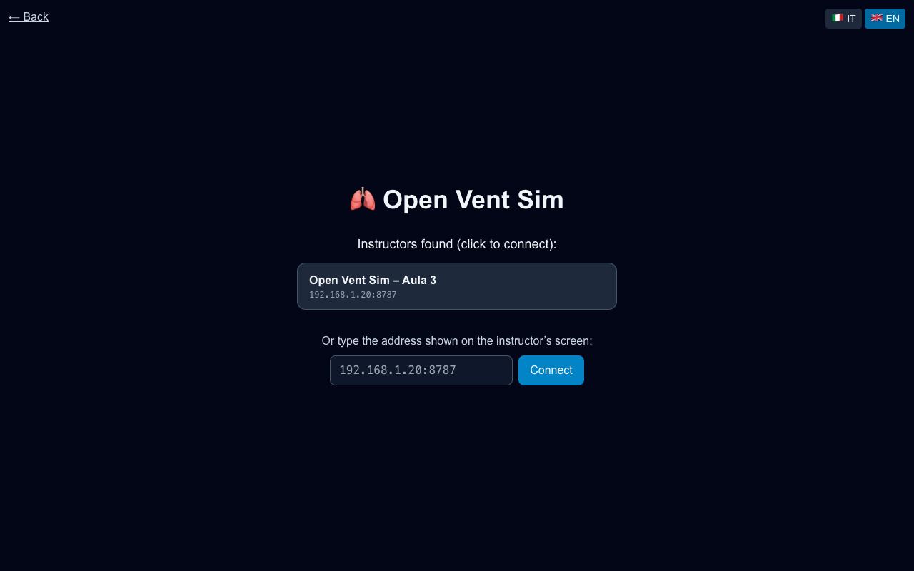</p>

If asked for a **PIN**, they type the 4 digits shown on the console:

<p align="center">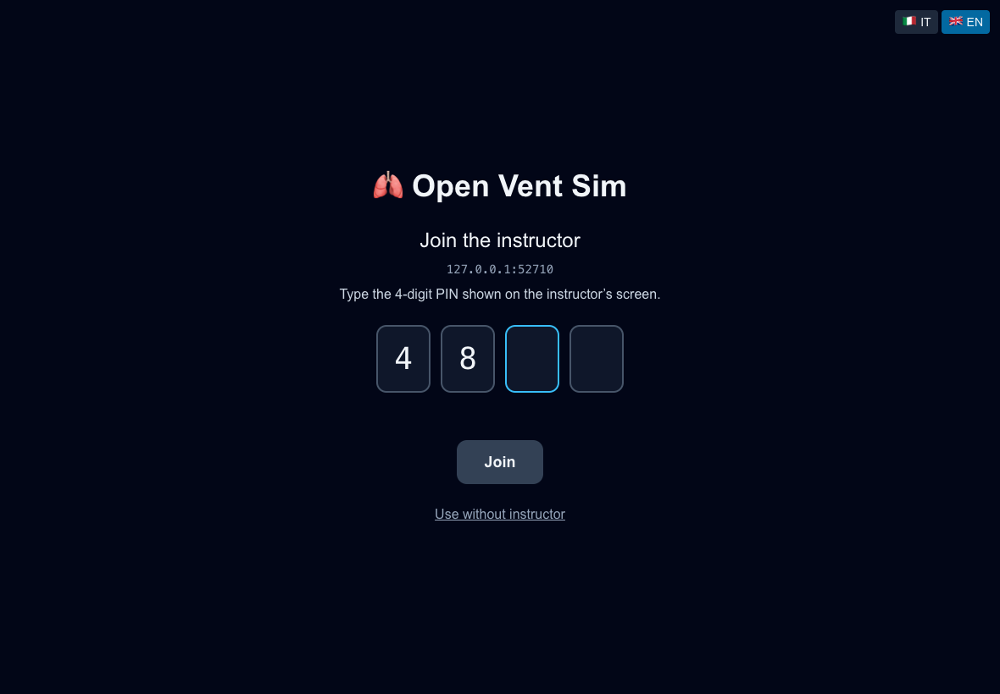</p>

A small dot appears in the top-right corner: **green** means connected to the instructor (tap it to read the status; a small red mark on it means the session is being recorded).

### The learner switches the machine on

1. Choose the machine.

<p align="center">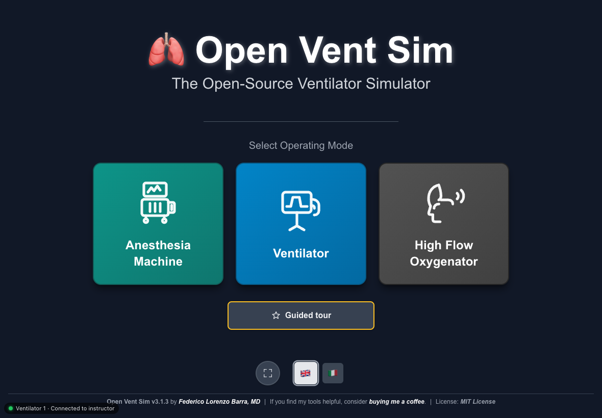</p>

2. For the ICU, choose **invasive** or **non-invasive**, then confirm **weight and age**, as on a real ventilator. The clinical picture (lung, asynchronies, teaching traces) is not the learner's choice: you set it from the console.

<p align="center">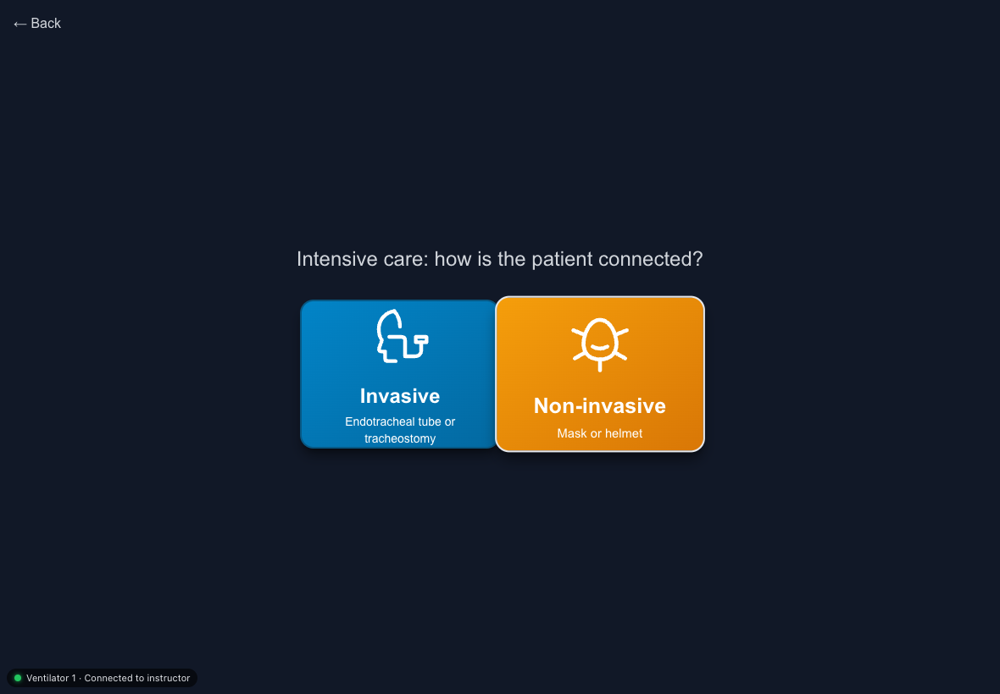 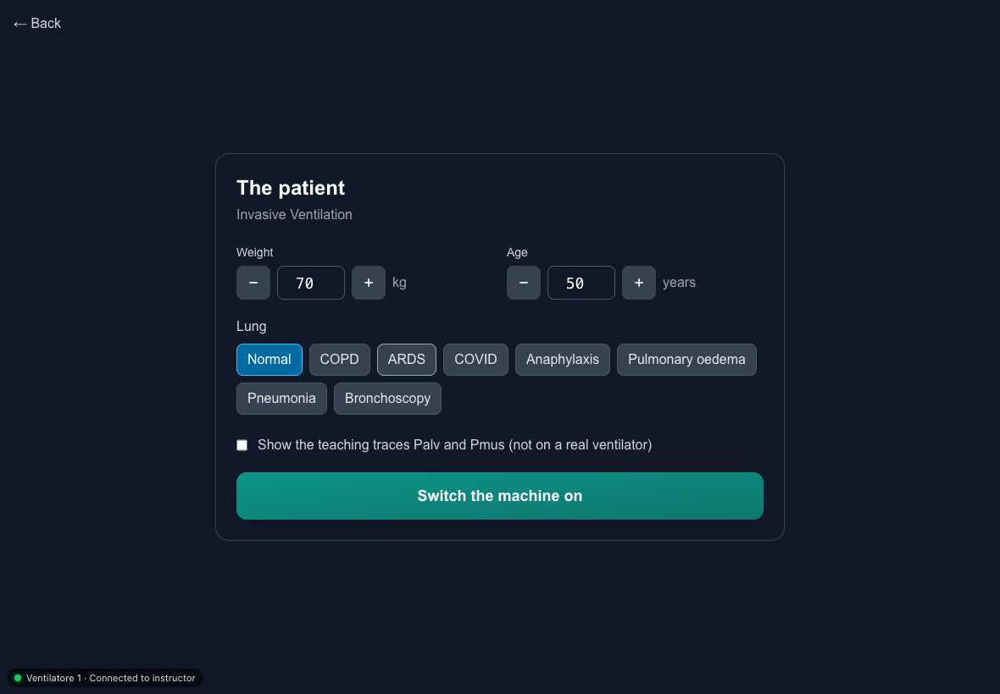</p>

3. Open the **STANDBY** drawer (left) and press **START VENTILATION**.

<p align="center">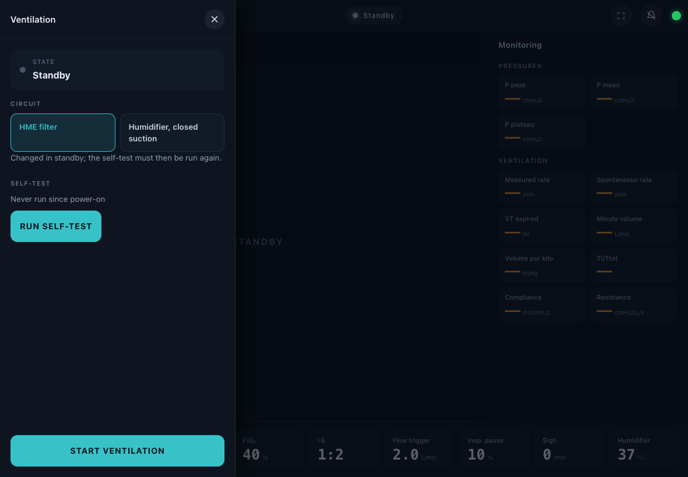</p>

<p align="center">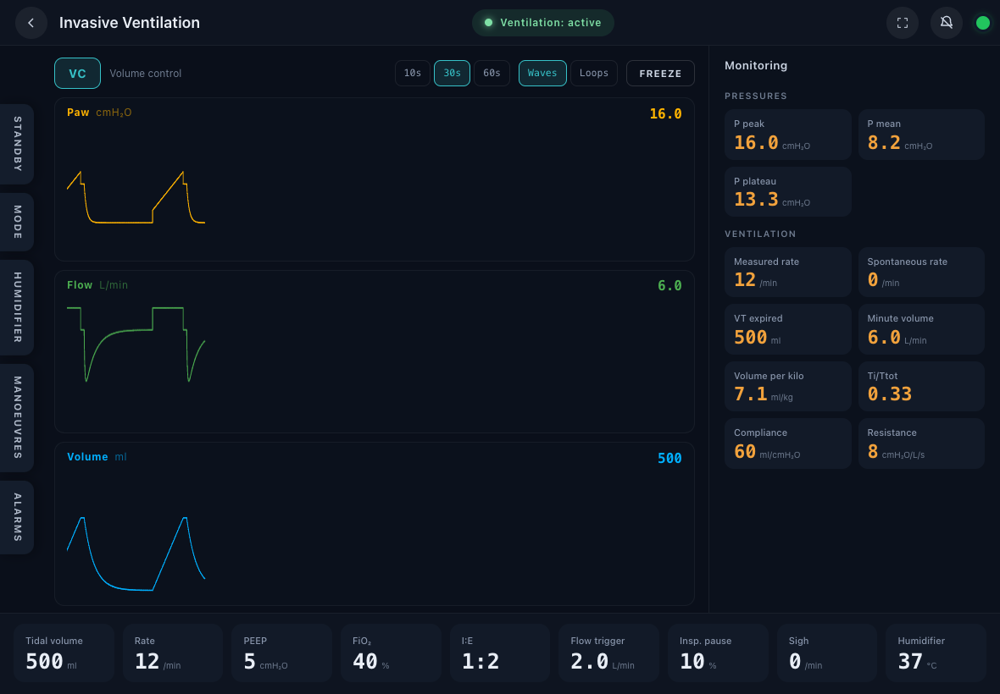</p>

From now on you see it on the console, waveforms included, and each action appears in the log on the right.

## 5. Using it on your own

Open the app and choose **On my own**, or open the simulator in a browser and click **Use without instructor**. Without an instructor, the patient screen shows an **Exercise settings** box (lung picture and teaching traces) to set up the case yourself. The start screen has a **Guided tour** button that walks a learner through their first ventilation.

<p align="center">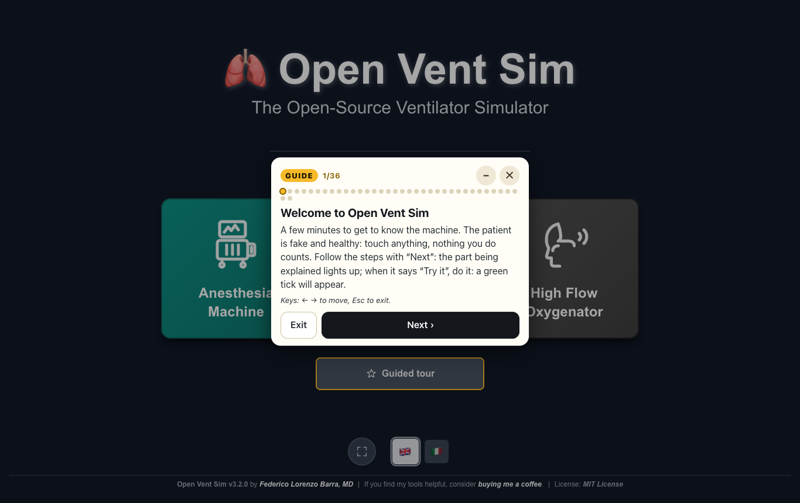</p>

### Waves, loops and hidden pressures

Above the waveforms there are the **Waves / Loops** buttons and, when enabled, **Palv·Pmus**:

- **Waves / Loops**: "Loops" shows the **pressure–volume** and **flow–volume** loops of the last breath. White is the breath in progress, the two before are fainter. **Keep as reference** freezes the current loop in grey: change PEEP or volume and compare.
- **Palv·Pmus** (off by default: real ventilators don't have it). The instructor enables it in the *Machine* tab, or a learner on their own ticks "Show the teaching traces" on the patient screen. It adds two traces. **Palv** is the pressure in the alveoli (Paw minus the resistive drop): it shows auto-PEEP before you measure it. **Pmus** is the patient's effort: it tells *when* they pull relative to the machine, which is how asynchronies are read.

<p align="center">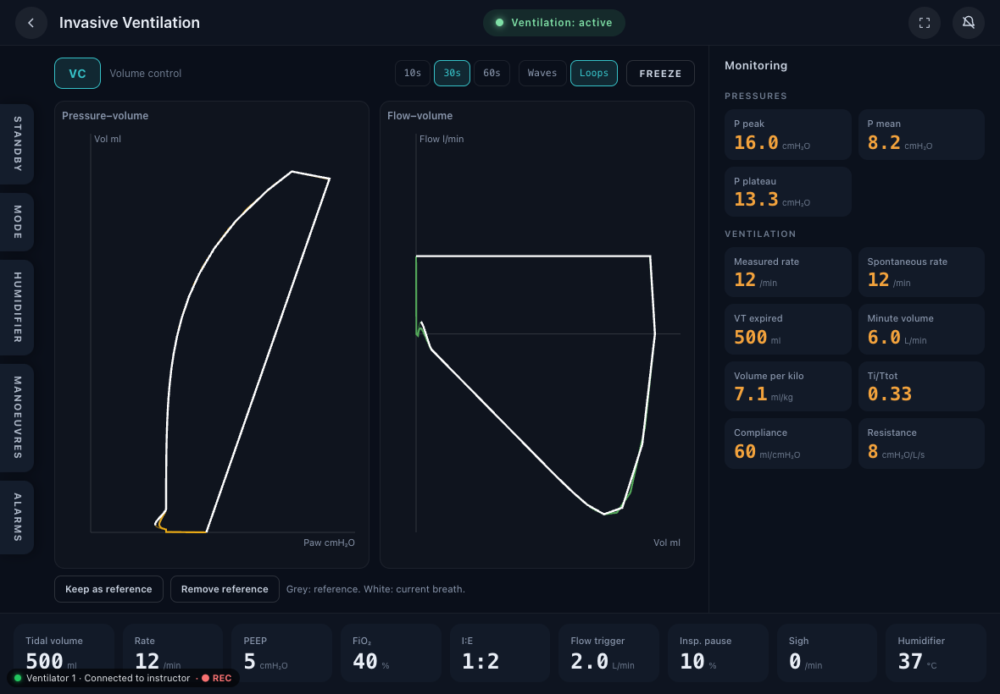</p>
<p align="center">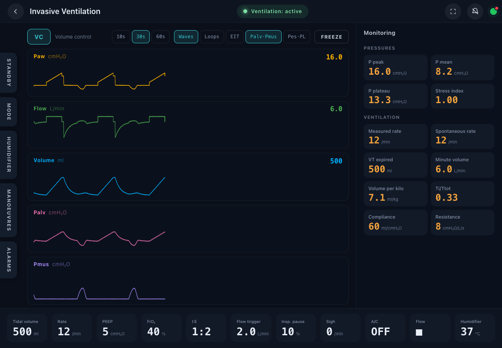</p>

**PRVC** (pressure-regulated volume control), in invasive ICU: you set the volume; the machine starts with a 10 cmH₂O test breath and changes the pressure by at most 3 cmH₂O per breath until the volume is reached. If compliance falls, pressure rises by itself — which is the point to teach. The regulator reads the breaths actually delivered: if the patient pulls, the machine lowers the pressure.

### The breathing engine, EIT and the new manoeuvres (3.2)

The waveforms come from a **breathing engine**: the equation of motion integrated at 200 Hz, with the patient's effort inside. Auto-PEEP builds up breath by breath, an ineffective effort is a real effort that misses the trigger, a double trigger is an effort longer than the machine's inspiration. The engine was validated against the simulator by T. Piraino (sim.rtmaven.com, reviewed by G. Bellani): tidal volumes within 1–2%, pressures within 0.5 cmH₂O (comparison in `docs/confronto-rtmaven.md`).

- **PAV+** and **A/C** (trigger open in VC, PC, PRVC; off by default). **Decelerating flow** in VC.
- **Pes·PL**: oesophageal and transpulmonary pressure, with the cardiac artefact.
- **P0.1** (when the patient opens the breaths) and **stress index** (VC, square flow) on the display.
- **EIT** (invasive ICU): tidal and dynamic image, global/ventral/dorsal impedance, pendelluft with vigorous efforts, and a **PEEP trial** with collapse/overdistension curves and their crossing (Costa 2009).
- **Manoeuvres**: the expiratory hold becomes an **occlusion test** when the patient pulls (ΔPocc, estimated Pmus and dynamic PL); **low-flow P/V curve** finds the airway opening pressure; **R/I ratio** (Chen 2020) from PEEP ≥ 10.
- In the instructor console, the **Effort & chest wall** tab: obesity, tense abdomen, airway closure, vigorous effort, irregular breathing, cardiac oscillations, grunting, active expiration; effort shape, effort that responds to support, breath-to-breath variability. The **Machine** tab saves and loads a **scenario** (patient and machine) as a file.

| Anaesthesia | Non-invasive | High flow |
|---|---|---|
| 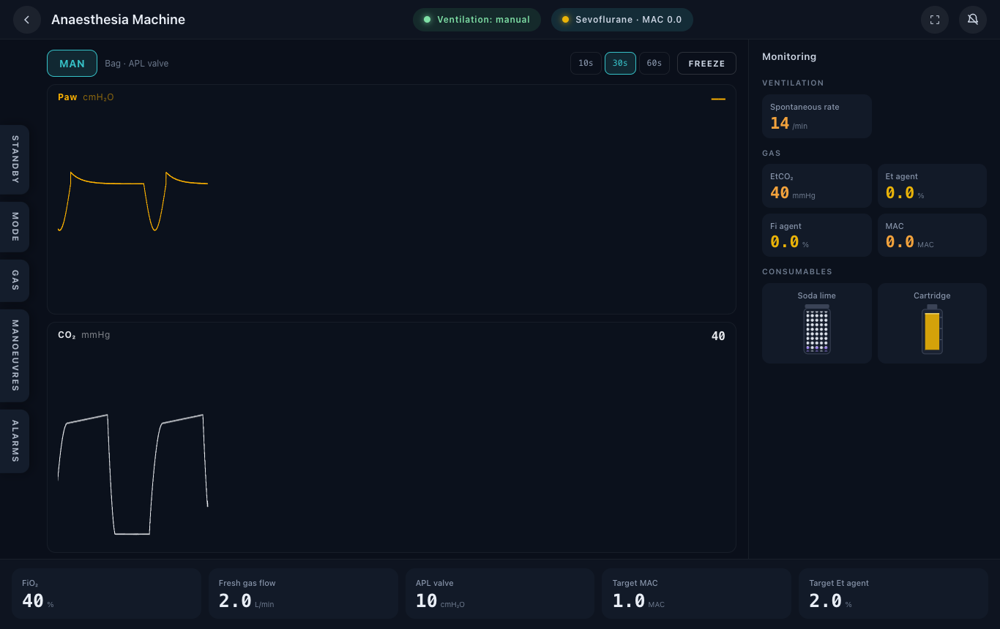 | 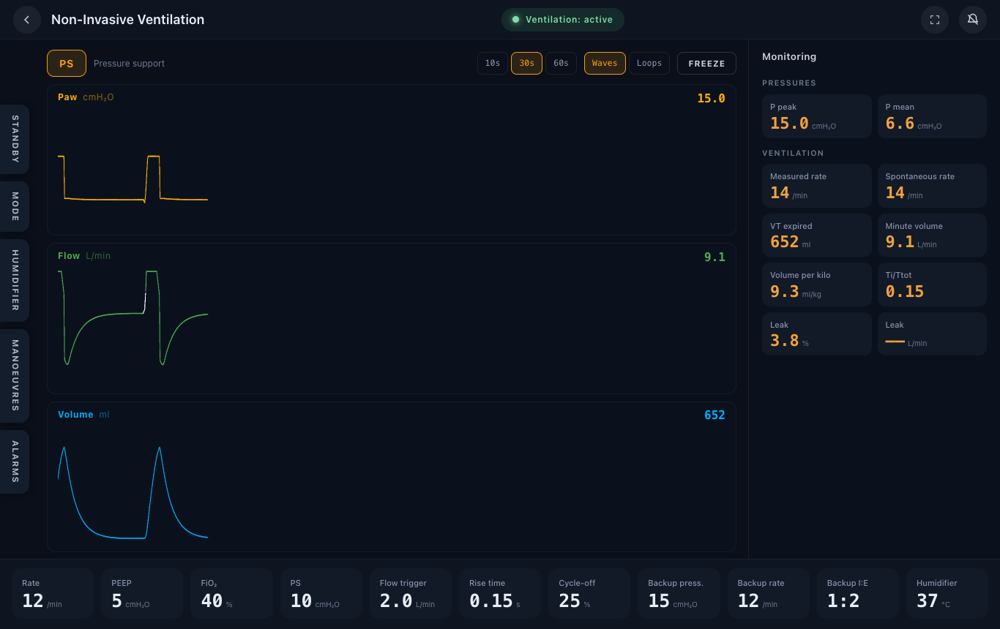 | 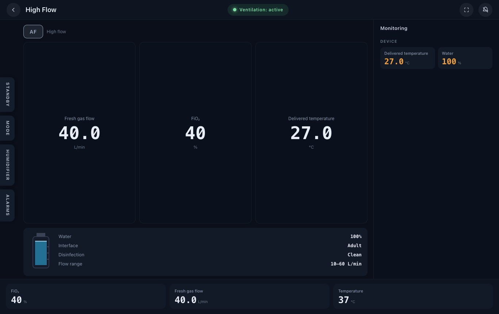 |

## 6. The instructor console in detail

At the top choose **where commands go**: *this ventilator* (selected on the left) or *all ventilators*.

| Tab | What you do |
|---|---|
| **Patient** | One-click clinical pictures (Normal, COPD, ARDS, COVID, Anaphylaxis, Pulmonary oedema, Pneumonia, Fibroscopy); compliance, resistance, effort, secretions; SpO₂, EtCO₂, heart rate, mean arterial pressure. With **"Change over"** the change happens gradually (30 s – 5 min) instead of at once. |
| **Asynchronies** | Ineffective effort, double cycling, reverse triggering, flow starvation, premature/delayed cycling, auto-triggering, with the share of breaths affected. Learners only see the **waveforms**, never the name: spotting it is their job. |
| **Lung** | Recruitability and chest-wall compliance: compliance now depends on PEEP. Start the **recruitment manoeuvre**. |
| **Machine** | Mode, settings, start/standby, silence alarms, inspiratory and expiratory holds: applied as if the learner touched them (logged as instructor actions). |
| **Events** | Ready-made events (bronchospasm, mucus plug, pneumothorax, desaturation, hypercapnia, induction, waking up, NMB reversal…). Fire now or build a timed **sequence**; save it to a file for next time. |

<p align="center">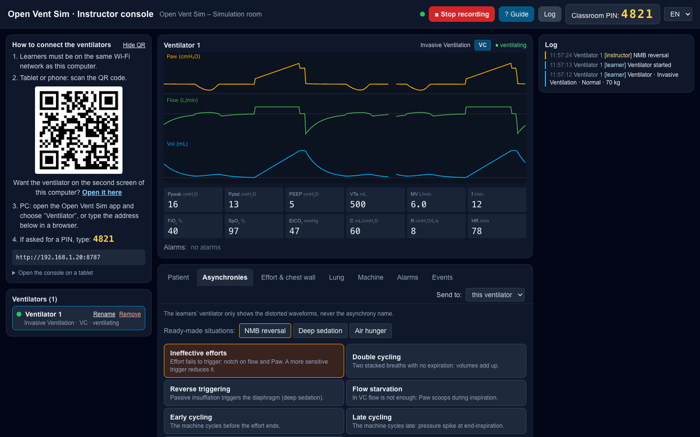</p>

<p align="center">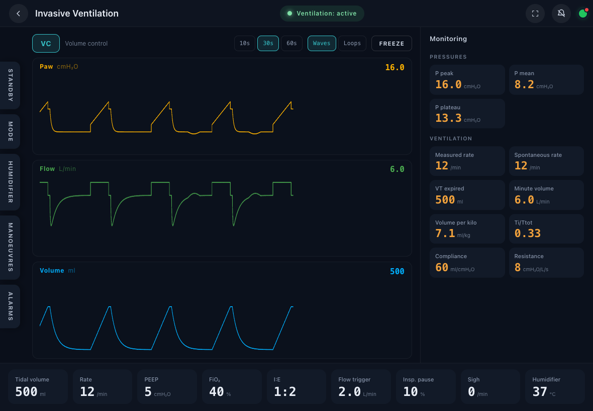</p>

<p align="center">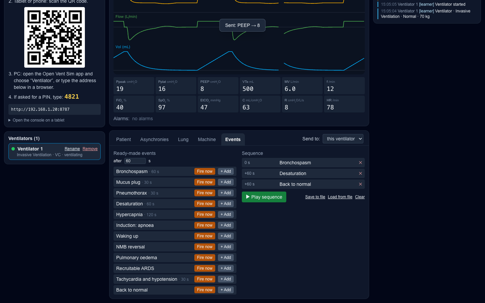</p>

**Console on a tablet.** In the left panel open "Open the console on a tablet" and scan the QR with **your** tablet to walk around the room with the console in hand. Don't show it to learners: it gives full control.

## 7. The session log

1. On the console press **● Record session**. Learners' ventilators show **● REC**.
2. Run the class.
3. Press **■ Stop recording**: the log opens.

<p align="center">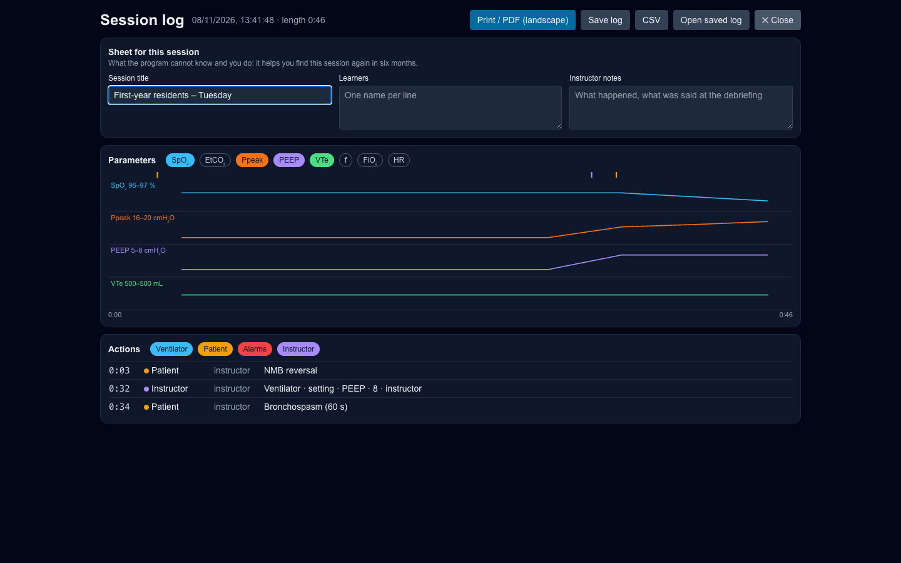</p>

- **Session sheet**: title, learners' names, debriefing notes.
- **Parameters**: SpO₂, EtCO₂, Ppeak, PEEP, VTe, rate, FiO₂ and HR over time. Toggle the coloured pills; ticks at the top mark the actions.
- **Actions**: minute by minute (0:00 = start of recording), grouped as *Ventilator*, *Patient*, *Alarms* and *Instructor*. Several turns of the same knob within a minute become one line; click it to expand.
- **Print / PDF**, **Save log** (`.json`, reopen later with "Open saved log") and **CSV** for Excel.

The log survives closing and reopening the console.

## 8. Troubleshooting

| Problem | Fix |
|---|---|
| Learner **can't find the instructor** or the QR doesn't open | Check they're on the **same Wi-Fi** (not the "guest" network). On Windows you must have clicked **Allow access** the first time (§3); if you denied it: *Control Panel → Windows Defender Firewall → Allow an app* → tick Open Vent Sim. |
| Works on a PC but not on phones | The Wi-Fi isolates devices ("client isolation"), common in hospitals. Use your own router or a **phone hotspot** and connect everyone to it, console included. |
| "Wrong PIN" | The PIN changes at every start of the console: use the one shown now, top right. |
| The top-right dot turns **orange** and says "Network lost – reconnecting…" | Do nothing: it reconnects by itself when the network is back, and the ventilator keeps running. |
| "Opened in another window" | The same ventilator is open in two tabs: close one. |
| The address changed since last time | Normal, it depends on the router. Always use what the console shows **today**. |
| Port 8787 is busy | The console moves to the next one (8788, 8789…) by itself: the right address is always the one on screen. |
| Mac says the app is "damaged" | Open Terminal, type `xattr -cr "/Applications/Open Vent Sim.app"`, then reopen. |
| I want the old (2.x) interface | In the browser, add `?legacy=1` to the address (stand-alone only). |

## 9. What's new

### 3.2.0 — 9 November 2026

- Breathing engine (equation of motion, deterministic for the classroom network), validated against sim.rtmaven.com.
- PAV+, A/C, decelerating flow, Pes·PL, P0.1, stress index, EIT with PEEP trial and pendelluft.
- Occlusion test, low-flow P/V curve (airway opening pressure), R/I ratio.
- Console: *Effort & chest wall* tab, scenario save/load. PRVC reads the delivered breaths.
- NIV: the console sets a **real mask leak** (l/min): VTi above VTe, delayed cycling, auto-triggering, pressure not reached with the mask off the face. New *Leak* reading in l/min.
- **Ventilator on the second screen**: one button in the console opens a ventilator, already joined, full screen on the projector or interactive whiteboard (Esc leaves full screen). Learners still need nothing installed: any browser on the same network (iPad included) opens the ventilator from the QR code or the address and PIN.
- Guided tour: steps for every new function.

### 3.1.3 — 8 November 2026

- The footer shows the real app version (it always said 2.0.0).
- Removed start-screen buttons that did nothing (recording, settings, manual): recording is started from the instructor console.
- The connection status is a dot in the top-right corner and no longer covers the footer or the settings bar.

### 3.1.2 — 8 November 2026

- A learner linked to the console only enters weight and age: lung picture and teaching traces are the instructor's call. On your own they are still there, set apart as "Exercise settings".

### 3.1.1 — 8 November 2026

- Settings bar: long names ("Inspiratory pause") no longer wrap; the tile shows the short name, the full one is in the tooltip.

### 3.1 — 8 November 2026

- **Loops**: pressure–volume and flow–volume, with a reference loop to compare.
- **Palv** (alveolar pressure) and **Pmus** (patient effort) traces.
- **PRVC** mode in invasive ICU.
- Fixed: a patient who resumes breathing at the same rate as the machine (NMB reversal) now shows the efforts on the waveforms.

### 3.0 — 8 November 2026

- **Instructor console over the local network**: built-in server, QR, PIN, automatic discovery, automatic reconnection, many ventilators at once, console on a tablet.
- **New screens and engine** from Sim Scenario Creator: one layout for anaesthesia, invasive ICU and NIV, plus high flow. PEEP-dependent compliance, auto-PEEP, patient effort and seven asynchronies, recruitment manoeuvre, consumables, humidifier.
- **Session log** in the Scenario Creator style, started from the console, printable to PDF.
- **Guided tour** (familiarisation), English and Italian.
- **Desktop app** for Windows and Mac; works **offline** (React and Tailwind used to come from external CDNs).
- Redesigned start screen with original icons.
- Language follows the system and is remembered.

## 10. For developers

```bash
git clone https://github.com/fedebarra/open-vent-sim.git
cd open-vent-sim
npm install
npm run dev            # development, http://localhost:3000 (simulator only)
npm run server         # build + classroom server on the LAN (port 8787)
npm run desktop        # Electron app
npm test               # unit + server tests
npm run test:e2e       # end-to-end (console + learners in two browsers)
npm run screenshots    # regenerate every image in this README
npm run dist:mac       # .dmg installer   (npm run dist:win for Windows)
```

- `device/`: ventilator engine and screens (from Sim Scenario Creator; original names kept so they stay diff-able).
- `remote/`: console, link, session log. `server/ovs-server.mjs`: HTTP + WebSocket server and UDP beacon on the LAN. `electron/`: desktop app. `tour/`: guided tour.
- Releases build themselves on GitHub Actions when a `v*` tag is pushed.

**Development requires** Node.js 20 or later.

---

## 11. How to cite

If you use Open Vent Sim in a course, a thesis, a poster or a paper, please cite the article that describes it:

> Barra FL, Ricci S, Moro E, Travěnec J, Costa A, Carenzo L, Rodella G, Vaschetto R. *Simulator development using natural language: clinician-led innovation through artificial intelligence.* Advances in Simulation. 2026;11(1). [doi:10.1186/s41077-026-00467-2](https://doi.org/10.1186/s41077-026-00467-2)

```bibtex
@article{barra2026openventsim,
  author  = {Barra, Federico Lorenzo and Ricci, Serena and Moro, Edoardo and Trav{\v{e}}nec, Ji{\v{r}}{\'i} and Costa, Alessandro and Carenzo, Luca and Rodella, Giovanna and Vaschetto, Rosanna},
  title   = {Simulator development using natural language: clinician-led innovation through artificial intelligence},
  journal = {Advances in Simulation},
  year    = {2026},
  volume  = {11},
  number  = {1},
  doi     = {10.1186/s41077-026-00467-2}
}
```

On GitHub the same reference is behind the **“Cite this repository”** button (file `CITATION.cff`).

---

### Acknowledgements

Developed at Università del Piemonte Orientale, Novara, Italy. Clinical team: F.L. Barra MD, E. Moro MD, L. Carenzo MD, A. Costa MD, G. Rodella RN, R. Vaschetto MD PhD. Technical facilitators: S. Ricci PhD, J. Travenec MSc. Thanks to all the Anaesthesiology residents who gave feedback.

**Images for slides and articles:** [`docs/press/`](docs/press) holds high-resolution screenshots (2880×1800) in English and Italian, free to use under the project licence.

**Support:** [Issues](https://github.com/fedebarra/open-vent-sim/issues) · federico.barra@med.uniupo.it

**Licence:** MIT. Icons are original drawings made for this project.
